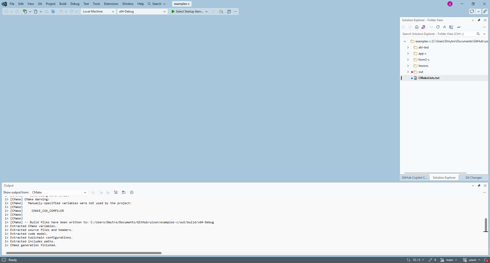
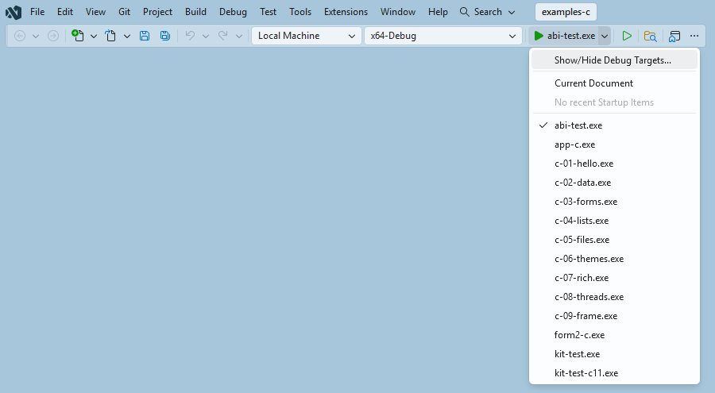
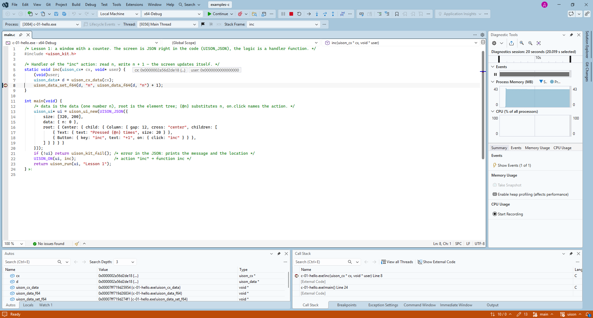

# Lesson 0. Setting up your system

**English** · [Русский](../../ru/c/lessons/00-setup.md)

**What you'll get:** a C compiler, CMake and the uison library on your machine; at the end — lesson 1.

You need:
- **a C compiler** — clang (macOS), gcc (Linux), MSVC from Visual Studio (Windows);
- **CMake** 3.19 or newer — it builds the lessons and your program;
- **the uison library** — **Rust** builds it from source (CMake runs it for you), or download a **prebuilt package** — then you don't need Rust;
- **git** — to get the source.

You don't need to install any libraries for windows, graphics or fonts: uison takes them from the system.

## macOS

1. The compiler and git come with Apple's command line tools:

   ```sh
   xcode-select --install
   ```

   If you have Xcode, you already have them. You need the full Xcode only for iPhone ([lesson 10](10-everywhere.md)).
2. CMake: `brew install cmake` ([Homebrew](https://brew.sh)) or the `.dmg` from [cmake.org](https://cmake.org/download/) (then run `sudo "/Applications/CMake.app/Contents/bin/cmake-gui" --install` in a terminal).
3. Rust (it builds the library):

   ```sh
   curl --proto '=https' --tlsv1.2 -sSf https://sh.rustup.rs | sh
   ```

   Press Enter for the default installation; then open a new terminal window.

## Linux

| distribution | command |
|---|---|
| Ubuntu, Debian, Mint | `sudo apt install build-essential cmake curl git` |
| Fedora | `sudo dnf install gcc cmake curl git` |
| Arch, Manjaro | `sudo pacman -S --needed base-devel cmake curl git` |
| openSUSE | `sudo zypper install gcc cmake curl git` |

Then Rust — the same way as on macOS. You don't need the `-dev` packages (Wayland, X11, Cairo, Pango): uison loads these libraries at run time, and the program depends only on libc. You need a desktop with Wayland or X11.

## Windows

> The "Visual Studio" part was checked live with Visual Studio 2026 (Open Folder, startup item, debugging — screenshots below); the installation itself has not yet been walked through on a clean Windows.

1. **Visual Studio Community** (free; 2026, 2022 works too): [visualstudio.microsoft.com](https://visualstudio.microsoft.com/downloads/). In the installer, on the "Workloads" tab, check **"Desktop development with C++"**. It includes the MSVC compiler, the Windows SDK and CMake — you don't need to install them separately. About 7 GB.
2. **Git**: [git-scm.com](https://git-scm.com/download/win) or `winget install Git.Git`.
3. **Rust**: [rustup-init.exe](https://rustup.rs) — press Enter (default installation). Visual Studio is already installed, so the installer finds MSVC right away.
4. Open a new terminal window so the paths are picked up. The `cl` and `cmake` commands are available in the **"Developer Command Prompt for VS"** (Start menu; for VS 2022 the name ends with "2022"), and in Visual Studio right away.

### Visual Studio

Visual Studio opens a CMake project without a `.sln`:

1. **File → Open → Folder…** — the folder with `CMakeLists.txt` (for the lessons, `examples-c` from the uison repository). Visual Studio runs CMake by itself; the first time, CMake calls cargo and builds the library — a minute or two, with progress in the "Output" window.

   

2. On the toolbar, pick the configuration (**x64-Debug** is created by itself; others live in `CMakeSettings.json` or `CMakePresets.json`) and the **"Select Startup Item"** — the program, for example `c-01-hello.exe` (at first Visual Studio picks the first program of the list by itself).

   

3. **F5** builds and runs under the debugger, **Ctrl+F5** — without it. A breakpoint in a handler (`inc` in lesson 1) is hit when you press the button: you can see `cx`, the data, the stack.

   

4. The program is in `out\build\x64-Debug\` inside the project folder.
5. Non-ASCII text in strings: uison sources are UTF-8, and the compiler needs the `/utf-8` switch (the lessons already have it in `CMakeLists.txt`).

The other way is without the Visual Studio IDE: the "Developer Command Prompt" and a single `cl` command ([quick start](../quickstart.md#option-b-a-single-compiler-command)).

## A prebuilt package instead of Rust

If you'd rather not install Rust: the repository releases (tags `v*`) contain the packages `uison-macos`, `uison-linux-x86_64`, `uison-windows-x64`… Unpack one and give CMake the path:

```sh
cmake -S examples-c -B build -DUISON_PACKAGE=/path/to/uison-macos
```

## Editor

- **Visual Studio** (Windows) — see above.
- **VS Code** + the **C/C++** and **CMake Tools** extensions: "CMake: Select Kit" (compiler), "CMake: Build", F5.
- **CLion** — opens `CMakeLists.txt` as a project.

## Checking

```sh
cc --version        # Windows: cl (in the "Developer Command Prompt")
cmake --version     # 3.19 or newer
rustc --version     # not needed if you took a prebuilt package
git --version
```

Lesson 1 from the uison repository:

```sh
git clone https://github.com/MarketKernel/uison
cd uison
cmake -S examples-c -B out/c/build -DCMAKE_BUILD_TYPE=Release
cmake --build out/c/build --target c-01-hello --config Release
./out/c/build/c-01-hello          # Windows: out\c\build\Release\c-01-hello.exe
```

A window with a "+1" button opens.


If something goes wrong:
- `Could not find UISON_CARGO` — Rust isn't installed, or the terminal window was opened before the installation; or take a prebuilt package (`-DUISON_PACKAGE=…`);
- `No CMAKE_C_COMPILER could be found` — no compiler: on macOS — `xcode-select --install`, on Linux — `build-essential` / `gcc`, on Windows — the "Desktop development with C++" workload;
- on Linux the window doesn't open and the terminal shows a `Wayland: …` error — the program was started without a desktop (over SSH, in a container).

Next: [lesson 1: a window and a button](01-hello.md).
