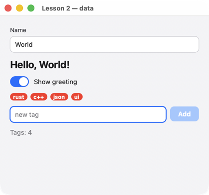

# Lesson 2. Data and bindings

**English** · [Русский](../../ru/c/lessons/02-data.md)

**What you'll get:** a "Name" field and a greeting that changes as you type; a switch that hides it; tag badges and a field that adds new ones.



<!-- code: examples-c/lessons/02-data/main.c -->
```c
/* Lesson 2: data and bindings. Elements read data by paths (@name), an input field writes it;
   code changes the data, and the screen follows it by itself. */
#include <uison_kit.h>

/* Derived data: derive is called after any change. */
static void count(uison_data* d, void* user) {
    (void)user;
    size_t n = uison_data_len(d, "tags");
    uison_data_set_f64(d, "count", (double)n);
    uison_data_set_bool(d, "many", n >= 5);
}

/* A new tag goes to the end of the array: %s escapes the string itself (quotes, \, line breaks). */
static void add(uison_cx* cx, void* user) {
    (void)user;
    uison_data* d = uison_cx_data(cx);
    uison_data_pushf(d, "tags", "%s", uison_data_str(d, "draft"));
    uison_data_set_str(d, "draft", "");
}

int main(void) {
    uison_ui* ui = uison_ui_new(UISON_JSON({
        size: [420, 360],
        data: { name: "World", show: true, tags: ["rust", "c++"], draft: "" },
        root: { Column: { padding: 20, gap: 12, cross: "stretch", children: [
            // Two-way binding: the field writes to name, the text below reads it.
            { TextField: { key: "name", label: "Name", value: "@name" } },
            { Text: { text: "Hello, {@name}!", size: 20, bold: true, visible: "@show" } },
            { Switch: { key: "show", label: "Show greeting", checked: "@show" } },
            // A list: For repeats the template for each element of the tags array.
            { Wrap: { gap: 6, children: [ { For: { each: "@tags", as: "t", do: { Badge: { text: "@t" } } } } ] } },
            { Row: { gap: 8, children: [
                { TextField: { key: "draft", value: "@draft", placeholder: "new tag", flex: 1, on: { submit: "add" } } },
                { Button: { key: "add", text: "Add", disabled: "!@draft", on: { click: "add" } } },
            ] } },
            // A conditional value: a switch on data.
            { Text: { text: "Tags: {@count}", color: { switch: "@many", cases: { true: "$theme.danger" }, default: "$theme.muted" } } },
        ] } }
    }));
    if (!ui) return uison_kit_fail();
    uison_ui_derive(ui, count, NULL, NULL);
    UISON_ON(ui, add);
    return uison_run(ui, "Lesson 2 — data");
}
```

## How it works

1. **Two-way binding.** `TextField { value: "@name" }` shows `name` and writes to it as you type. `Text { text: "Hello, {@name}!" }` reads the same value — the greeting changes with every letter, with no handlers.
2. **Visibility.** `visible: "@show"` — the node exists while `show` is truthy; `"!@show"` — the opposite. Falsy values are `false`, `0`, `""`, `[]`, `null`.
3. **Lists.** `For { each: "@tags", as: "t", do: … }` repeats the template for each element of the `tags` array; inside it, `@t` is the current element.
4. **Formatted data.** `uison_data_pushf(d, "tags", "%s", text)` appends to the array a value built from a format: `%s` is a quoted string with `"`, `\` and line breaks escaped. The format is JSON: `uison_data_pushf(d, "todos", "{ id: %d, title: %s, done: %s }", id, t, UISON_B(done))`. The compiler checks argument types, as with `printf`.
5. **Derived data.** `uison_ui_derive(ui, count, …)` is called after every data change: here it counts the tags. The screen is bound to the result (`{@count}`), so the counter is always correct.
6. **Choosing a value.** `color: { switch: "@many", cases: { true: "$theme.danger" }, default: "$theme.muted" }` — a color driven by data. Selectors and functions (`eq`, `not`, `len`…) are in the [bindings reference](../../screens/bindings.md).

**Formatting** (`uison_data_setf`, `uison_data_pushf`, `uison_fmt`):

| | what it writes |
|---|---|
| `%s` | a quoted, escaped string; `NULL` — `null`; `UISON_B(x)` — `true` / `false` |
| `%d %u %ld %lld %zu …` | an integer |
| `%g %f %e` | a number, independent of the locale (a decimal point even where the locale uses a comma); `%g` without precision — the shortest form; NaN — `null` |
| `%c`, `%%` | a character as a string, a percent sign |

Write `null` directly in the format: GCC warns about a literal `NULL` for `%s`.

## Try it

- Don't add an empty tag or a tag that already exists.
- Remove a tag when its badge is tapped: `key: "tag-{@t}"`, and the handler reads `uison_cx_key`.

Next: [lesson 3: a form with validation](03-forms.md).
