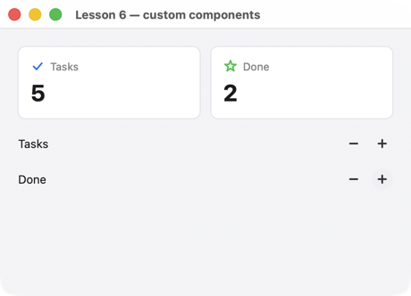

# Lesson 6. Custom components

**English** · [Русский](../../ru/cpp/lessons/06-components.md)

**What you'll get:** your own elements `Stat` (a card with a number) and `Counter` (a row with "−" and "+" buttons), defined in a JSON file and used in code like the standard widgets, with IDE hints and name checking.



<!-- code: examples-cpp/lessons/06-components/main.cpp -->
```cpp
// Lesson 6: custom components. components.json holds the Stat and Counter templates; CMake generates
// C++ widgets for them (uison_generate_widgets → app_widgets.hpp), so custom elements are written the same
// way as standard ones: app::Stat({.title = …}), with hints and field names checked by the compiler.
#include <string>

#include "app_widgets.hpp"

using namespace uison::widgets;

int main() {
    auto screen = Column({.padding = 20, .gap = 16, .cross = "stretch", .children = {
        Row({.gap = 12, .children = {
            app::Stat({.title = "Tasks", .value = "@tasks", .icon = "check"}),
            app::Stat({.title = "Done", .value = "@done", .icon = "star", .color = "$theme.success"}),
        }}),
        app::Counter({.label = "Tasks"}),
        app::Counter({.label = "Done"}),
    }});
    // Components come from the same JSON as for the generator (CMake puts the file next to the program).
    uison::Ui ui(screen, {.size = {460, 300}, .data = uison::obj{{"tasks", 3}, {"done", 1}}});
    ui.components_file("components.json");
    // One handler for several buttons: which one was pressed comes from the key ("inc-Tasks", "dec-Done").
    auto change = [](uison::Cx& cx, int step) {
        auto path = cx.key().find("Tasks") != std::string_view::npos ? "tasks" : "done";
        int v = cx.data().get<int>(path) + step;
        cx.data().set(path, v < 0 ? 0 : v);
    };
    ui.on("inc", [change](uison::Cx& cx) { change(cx, 1); });
    ui.on("dec", [change](uison::Cx& cx) { change(cx, -1); });
    return ui.run("Lesson 6 — custom components");
}
```

The components are in `components.json`:

<!-- code: examples-cpp/lessons/06-components/components.json -->
```js
// Custom components: params are the parameters with default values (a comment on a parameter ends up
// in the widget's hints), body is the tree, inside it parameters are $name.
{
  Stat: {
    params: {
      title: "", // caption
      value: 0, // the number, large
      icon: "star", // an icon from the Icon set
      color: "$theme.primary", // icon color
    },
    body: {
      Box: {
        flex: 1, padding: 14, radius: "$theme.radius", fill: "$theme.card", stroke: "$theme.divider",
        child: { Column: { gap: 6, children: [
          { Row: { gap: 6, cross: "center", children: [
            { Icon: { name: "$icon", size: 16, color: "$color" } },
            { Text: { text: "$title", size: 12, color: "$theme.muted" } },
          ] } },
          { Text: { text: "{$value}", size: 26, bold: true } },
        ] } },
      },
    },
  },

  // Button keys come from a parameter: each Counter has its own buttons, one handler (it tells the button by key).
  Counter: {
    params: { label: "" },
    body: {
      Row: { gap: 8, cross: "center", children: [
        { Text: { text: "$label", flex: 1 } },
        { IconButton: { icon: "minus", size: "sm", key: "dec-{$label}", on: { click: "dec" } } },
        { IconButton: { icon: "plus", size: "sm", key: "inc-{$label}", on: { click: "inc" } } },
      ] },
    },
  },
}
```

## How it works

1. **A component** is a template: `params` (the parameters and their default values) and `body` (the tree; inside it, parameters are written as `$name`). A comment on a parameter ends up in the IDE hint for the widget field.
2. **Widgets from the generator.** In `CMakeLists.txt`:

   ```cmake
   uison_generate_widgets(cpp-06-components lessons/06-components/components.json)
   ```

   CMake generates `app_widgets.hpp` (namespace `app`) and regenerates it whenever `components.json` changes. In code it is `app::Stat({.title = …, .value = …})`: the fields are the component's parameters, plus the common ones (`w`, `flex`, `key`…) and events. The generator is `uison-gen` (built from source or shipped in the package as `bin/uison-gen`); the namespace and file names are set with `NAMESPACE` and `OUTPUT`.
3. **Components in `Ui`.** The widget only builds the node `{ Stat: { … } }`; what `Stat` is, `Ui` learns from the same JSON: `ui.components_file("components.json")` (CMake puts the file next to the program) or `.components = R"json({…})json"` in `uison::Screen`.
4. **One handler, many buttons.** The button's key is built from a parameter: `"inc-{$label}"` → `inc-Tasks`. The handler tells the buttons apart by `cx.key()`.

## Try it

- Add a `hint` parameter to `Stat` — after a build it shows up right away as a field: `app::Stat({.hint = …})`.
- A `Progress` component (a bar driven by `value` and `max`) under the counters.

Next: [lesson 7: themes and tokens](07-themes.md).
