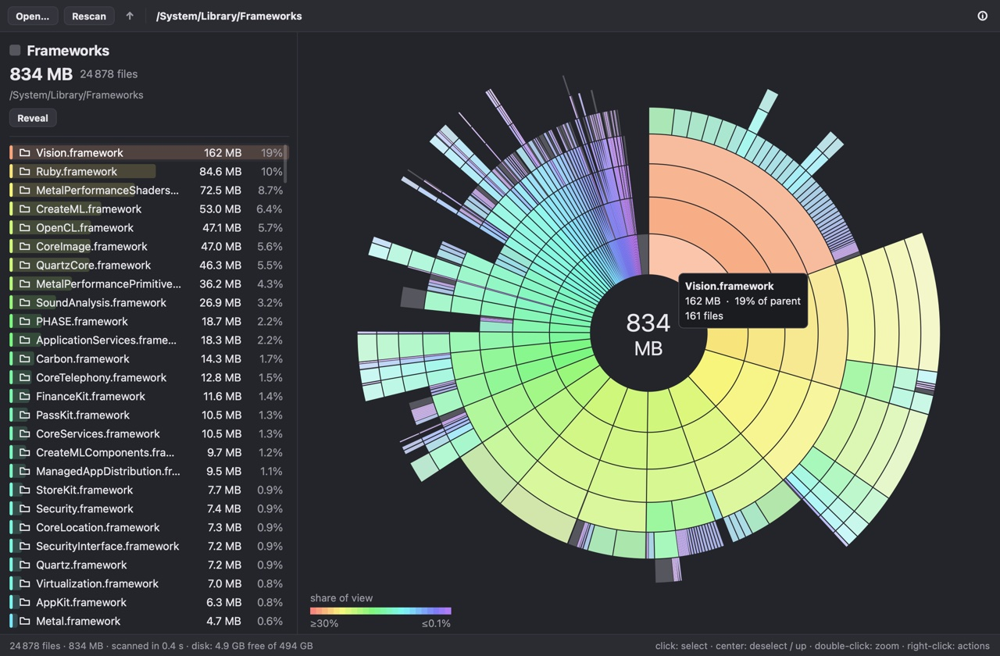

# uison

<!-- languages -->
<h3 align="center">
<a href="../../README.md">🇬🇧 English</a> ·
<a href="README.zh.md">🇨🇳 中文</a> ·
<a href="README.hi.md">🇮🇳 हिन्दी</a> ·
<a href="README.es.md">🇪🇸 Español</a> ·
<a href="README.fr.md">🇫🇷 Français</a> ·
<a href="README.ar.md">🇸🇦 العربية</a> ·
<a href="README.bn.md">🇧🇩 বাংলা</a> ·
<a href="README.pt.md">🇧🇷 Português</a> ·
<a href="README.ru.md">🇷🇺 Русский</a> ·
<a href="README.ur.md">🇵🇰 اردو</a> ·
<a href="README.id.md">🇮🇩 Bahasa Indonesia</a> ·
<a href="README.de.md">🇩🇪 Deutsch</a> ·
<b>🇯🇵 日本語</b> ·
<a href="README.mr.md">🇮🇳 मराठी</a> ·
<a href="README.te.md">🇮🇳 తెలుగు</a> ·
<a href="README.tr.md">🇹🇷 Türkçe</a> ·
<a href="README.uk.md">🇺🇦 Українська</a>
</h3>
<!-- /languages -->

**uison**（UI + JSON）は Rust で書かれた小さく高速な UI フレームワークで、依存関係がまったくありません。
使うのは標準ライブラリだけで、JSON パーサーまで自前です。画面は要素のツリーとして記述します。JSON
ファイルで、Rust の DSL で、Flutter 風の C++ ウィジェットで、あるいは C のコードに直接 JSON を書いて。
ロジックは Rust、C、C++ の普通のコード（ハンドラー、データ、スレッド）です。ウィンドウ、レイアウト、描画、
入力は uison が引き受け、同じプログラムが macOS、Windows、Linux（Wayland と X11）、iOS、Android、
そしてブラウザーで動きます。

各バックエンドは手書きの FFI でシステムと直接やり取りします。AppKit と CoreText、Win32 と Direct2D・
DirectWrite（COM も手書き）、ゼロから実装した Wayland プロトコルと X11、UIKit、JNI 経由の Android
Canvas、そして WebAssembly からの 2D canvas。リリース版のプログラムは約 0.7–0.9 MB のファイル 1 つで、
システム標準のライブラリ以外は何も必要とせず、デスクトップではイベントが約 1 ミリ秒で画面に反映されます。



## 仕組み

```text
画面（JSON、Rust DSL、C++ ウィジェット、C の UISON_JSON）  +  データ  +  あなたの言語で書いたハンドラー
        │  バインディング、テンプレート、テーマ、レイアウト（uison-ui）
        ▼
プリミティブのフレーム：rect, line, circle, tri, poly, text, image, clip, hit
        │  前のフレームとの diff → 変わった部分だけを再描画
        ▼
システムのバックエンド：AppKit, Win32 + Direct2D, Wayland/X11 + Cairo, UIKit, Android Canvas, canvas 2D
```

画面は*フレーム*にコンパイルされます。フレームは数種類のプリミティブを並べたフラットなリストです。
矩形、線、円、多角形、1 行のテキスト、画像、クリップ領域、そしてマウスとタッチ用の見えないヒット領域。
新しいフレームは毎回前のフレームと比較され、バックエンドは変化した領域だけを再描画します。バックエンドが
小さいのは、これらのプリミティブを描き、テキストを計測し、システムのイベントを uison のイベントに変換する
だけでよいからです。

画面記述言語にはコードがありません。テキストやプロパティはデータにバインドされ（`"Pressed {@n} times"`、
`"disabled": "!@form.valid"`）、要素はパラメーター付きの再利用可能なテンプレート、色やサイズはテーマの
トークンから取られ、イベントは名前付きのアクションを呼び出します。そのハンドラーは Rust、C、C++ で書きます。
ハンドラーがデータを変更すると、画面は自動的に再構築されます。

## Hello, world

同じウィンドウ（カウンターと「+1」ボタン）を 3 つの言語で。

**Rust** — 画面は DSL で組み立て、ハンドラーはボタンに渡すクロージャーです：

```rust
use uison::prelude::*;

fn main() {
    let screen = center(column().gap(12).cross("center").children([
        text("Pressed {@n} times").size(20),
        button("+1").key("inc").on_click(|cx| cx.data.edit("n", |n: &mut i32| *n += 1)),
    ]));
    let mut ui = Ui::from_node(screen).with_size(320.0, 200.0);
    ui.data.set("n", 0);
    run(ui, "Hello");
}
```

**C** — 画面はコードに直接書いた JSON、ハンドラーは関数です：

```c
#include <uison_kit.h>

static void inc(uison_cx* cx, void* user) {
    (void)user;
    uison_data* d = uison_cx_data(cx);
    uison_data_set_f64(d, "n", uison_data_f64(d, "n") + 1);
}

int main(void) {
    uison_ui* ui = uison_ui_new(UISON_JSON({
        size: [320, 200],
        data: { n: 0 },
        root: { Center: { child: { Column: { gap: 12, cross: "center", children: [
            { Text: { text: "Pressed {@n} times", size: 20 } },
            { Button: { key: "inc", text: "+1", on: { click: "inc" } } },
        ] } } } }
    }));
    if (!ui) return uison_kit_fail(); /* prints the JSON error and where it is */
    UISON_ON(ui, inc);                /* action "inc" → function inc */
    return uison_run(ui, "Hello");
}
```

**C++** — Flutter 風のウィジェット、ハンドラーはボタンに渡すラムダです：

```cpp
#include <uison_widgets.hpp>

using namespace uison::widgets;

int main() {
    auto screen = Center({.child = Column({.gap = 12, .cross = "center", .children = {
        Text("Pressed {@n} times", {.size = 20}),
        Button("+1", {.key = "inc", .on_click = [](uison::Cx& cx) {
            cx.data().update<int>("n", [](int n) { return n + 1; });
        }}),
    }})});
    uison::Ui ui(screen, {.size = {320, 200}, .data = uison::obj{{"n", 0}}});
    return ui.run("Hello");
}
```

自分のプロジェクトを始めるには、[Rust](../rust/quickstart.md)、[C](../c/quickstart.md)、
[C++](../cpp/quickstart.md) のクイックスタートを参照してください。

## 特長

- **依存関係ゼロ。** コア、JSON パーサー、レイアウト、Wayland クライアント、Linux の設定ポータル用
  D-Bus クライアント、Windows 用の COM バインディングは、すべてこのリポジトリで `std` の上に書かれて
  います。`Cargo.lock` に載っているのはワークスペース自身のクレートだけです。
- **1 つのプログラムで 6 つのプラットフォーム。** macOS、Windows（x64 と ARM64）、Linux（Wayland と
  X11、arm64 と x86_64）、iOS、Android（arm64-v8a と armeabi-v7a）、ブラウザー（WebAssembly）。
  スマートフォンでは同じコードがタッチ、セーフエリア、スクリーンキーボード、慣性スクロールに対応します。
- **部分再描画。** フレームの diff を取り、変化した領域だけを再描画します。細い線はどのバックエンドでも
  同じ方法で物理ピクセルに揃えます。
- **要素ライブラリ**：ボタン、アイコンボタンと 25 個のアイコン、チェックボックス、ラジオボタン、スイッチ、
  スライダー、セレクト、タブ、選択とクリップボードに対応したテキストフィールド、プログレスバー、カード、
  リストタイル、バッジ、アバター、ツールチップ、コンテキストメニュー、リンク、画像。要素自体が JSON
  テンプレート（`lib/*.json`）で、独自のコンポーネントも同じ方法で書けます。
- **Flutter 風のレイアウト**：`Row`、`Column`、`Stack`、`Wrap`、`Align`、flex、スクロール、数万行に
  対応する仮想化リスト、そして `Flow`（インラインのテキストランをまたいで折り返す段落）。
- **バインディングと状態**：データへのパス（`@user.name`）、テキストの埋め込み、コンポーネントの
  ローカル状態（`@~open`）、状態（hover、pressed、focus）によるセレクター、`switch`、いくつかの関数
  （`eq`、`not`、`len`、`ratio`…）。構造体とデータは相互に変換できます。Rust では `#[derive(Data)]`、
  C ではフィールドテーブル、C++20 ではマクロなしのリフレクション。
- **テーマ**：ライト、ダーク、「システムに従う」。上書き可能なトークンで構成されます。
- **独自描画**：`Canvas` ノードがあなたの関数を呼び出し、普通の要素と並んで、自分の矩形にプリミティブを
  書き込ませます。
- **スレッド**：ワーカースレッドが結果を UI スレッドに送り返します（`post`）。ブラウザー以外のすべての
  プラットフォームで使えます。
- **ライブリロード**（デバッグビルド）：`UISON_RELOAD=folder` を指定すると、画面の JSON ファイルを
  保存したときに読み直します。
- **ウィンドウなしのテスト**：シナリオ（`UISON_SCRIPT=scenario.json`）が要素の `key` を指定してタップ、
  入力、スクロール、スクリーンショットを行います。同じシナリオがすべてのプラットフォーム、headless
  Chrome、iOS シミュレーター、実機のスマートフォンで動きます。
- **C と C++ の API**：`uison.h`（C99）、`uison_kit.h`（C 用ヘルパー）、`uison.hpp`（C++17、C++20
  ではさらに便利に）、`uison_widgets.hpp`（Rust DSL と同じスキーマから生成される C++20 ウィジェット）。
  静的・動的ライブラリ、CMake パッケージ、`pkg-config` を用意しています。C と C++ は Emscripten で
  ブラウザー向けにもビルドできます：`em++ main.cpp libuison.a -o index.html`。

## プラットフォーム

| プラットフォーム | バックエンド | 確認環境 |
|---|---|---|
| macOS | AppKit、CoreGraphics、CoreText、ImageIO を Objective-C ランタイム経由で | Apple Silicon の Mac（メインの開発マシン） |
| iOS | UIKit、CADisplayLink、macOS と同じ CoreGraphics/CoreText のコード | シミュレーターと iPhone 12 mini |
| Android | 手書きの JNI、`android.graphics.Canvas`、約 300 行の Java レイヤー。APK は Gradle なしでビルド | Huawei P40 lite（Android 10） |
| Windows | Win32、Direct2D、DirectWrite、WIC、COM は手書き。モニターごとの DPI、ダークなタイトルバー | Windows 11 の PC（100/125/150 %）、スケールの異なる 2 台のモニター |
| Linux | 自前の Wayland プロトコル実装と X11（xcb）、Cairo + Pango、xkbcommon。すべて `dlopen` 経由なので、バイナリーが依存するのは libc だけ | ヘッドレスの Mutter、KWin、Sway、Weston、X11（arm64 と x86_64）。仮想マシン上の GNOME 付き Ubuntu 24.04 |
| ブラウザー | wasm-bindgen を使わない `wasm32-unknown-unknown`、canvas 2D。C/C++ は Emscripten 経由 | Chrome（と headless Chrome） |

まだ確認していないもの：Windows の実際のタッチスクリーン、Windows on ARM（ビルドはできるが未実行）、
実機の Linux と KDE、GNOME でのマウスとキーボード入力、Safari と Firefox。

## サイズと速度

リリースビルド（`opt-level = "s"`、LTO、`panic = "abort"`、strip 済み）。サイズはプロジェクトの成長に
合わせて行ってきた計測によるもので、最新のビルドでは数パーセント異なる場合があります。

| プログラム | サイズ |
|---|---|
| レッスン 1（上のカウンター）、Rust、macOS | ~0.7 MB |
| 同じものを C / C++ で `libuison.a` と、macOS | 672 KB / 816 KB |
| Studio — メインのデモ（2,000 通のメール、カンバン、連絡先、グラフ、フォーム）、macOS | ~840 KB |
| Studio、Windows x64 / ARM64 | 672 KB / 613 KB、Visual C++ Redistributable 不要 |
| Studio、Linux arm64 / x86_64 | 857 KB / 936 KB |
| Studio、Android `libmain.so` arm64 | ~820 KB |
| Studio、ブラウザー（`.wasm`、gzip） | ~220 KB |

| 計測項目 | 結果 |
|---|---|
| イベント → ウィンドウの描画完了、macOS | ~0.8 ms、うち uison 自身の処理は ~0.2 ms |
| タッチ → フレーム、iPhone 12 mini | 3.6 ms。リストのスクロールは安定した 60 fps |
| Studio の全体再描画、iPhone 12 mini / Huawei P40 lite | 0.7 ms / 0.4–0.7 ms |
| マウスイベント → フレーム、Windows（Iris Xe、60 Hz） | p50 1.4–1.7 ms |
| イベント → フレーム、Chrome | 中央値 2.2 ms |
| 起動 → 最初のフレーム | iOS 37–41 ms、Android 58–68 ms、Windows 73–103 ms、ブラウザー 24–42 ms |

egui のプログラムを移植した [Disk Usage](../../examples/disk-usage/README.md) で直接比較できます。
macOS arm64 でバイナリーは 5.1 MB ではなく 857 KB、`Cargo.lock` の 362 個のクレートの代わりに依存関係
ゼロで、スキャン速度とメモリ使用量は同じです。

## ドキュメント

ドキュメントは英語で、すべてのページに[ロシア語版](../ru/README.md)があります。

- [言語を選ぶ](../README.md) — どこから始めるか。
- レッスンシリーズ。それぞれ単独で読め、システムの準備からスレッドや独自フレームまで扱います：
  [Rust](../rust/README.md)、[C](../c/README.md)、[C++](../cpp/README.md)。
  コアのレッスンは 3 つの言語で同じプログラムで、スクリーンショットはピクセル単位で一致します。
- [画面記述言語](../screens/README.md)：[バインディングと値](../screens/bindings.md)、
  [レイアウト](../screens/layout.md)、[要素](../screens/elements.md)、
  [テーマ](../screens/themes.md)。
- [iOS と Android](../mobile.md)、[ブラウザー（WebAssembly）](../wasm.md)。

## サンプル

| サンプル | 内容 |
|---|---|
| `studio` | メインのデモ：2,000 通のメール、カンバン、連絡先、アニメーション付きグラフ、フォーム、設定。700 pt 未満ではスマートフォン用レイアウト |
| `gallery` | ライブラリのすべての要素 |
| `disk-usage` | egui アプリの移植：`Canvas` ノードで描くサンバーストチャート、uison の画面としてのパネルとメニュー、`std` による並列スキャナー |
| `browser` | 小さな Web ブラウザー：自前の HTML・CSS パーサーとカスケード、HTTP、システムの TLS による HTTPS。ページは uison の画面になる |
| `todo` | Rust DSL で書いた ToDo リスト |
| `list10k` | 10,000 行の仮想化リスト |
| `form2`, `settings` | フォームと設定画面 |
| `demo`, `scroll`, `uibench` | 手書きのプリミティブ、スクロール、ベンチマーク |

```sh
cargo run --release -p studio
cargo run --release -p disk-usage -- ~/Downloads
cargo run --release -p browser
```

C と C++ のサンプルは [`examples-c`](../../examples-c) と [`examples-cpp`](../../examples-cpp) にあり、
それぞれが独立した CMake プロジェクトです。

## ビルドとテスト

必要なのは stable の Rust だけで、macOS、Windows（MSVC ツールチェーン）、Linux ではほかに何もいりません
（`-dev` パッケージも不要：システムライブラリは実行時に読み込みます）。各システムの準備は、どのシリーズでも
レッスン 0 です（[Rust](../rust/lessons/00-setup.md)）。

```sh
cargo test --workspace && cargo clippy --workspace   # tests
cargo run --release -p studio                        # a window on macOS, Windows or Linux
tools/web.sh studio && python3 tools/serve.py target/web/studio 8000   # the browser
tools/ios.sh studio sim                              # iOS simulator (Xcode)
tools/android.sh studio                              # an APK without Gradle (Android SDK and NDK)
tools/c-dist.sh macos                                # the C/C++ package in dist/uison-macos
tools/lessons.sh                                     # build every lesson, run its scenario, update the screenshots
```

Windows ではスクリプトは `tools\*.ps1` です。`tools\win.ps1 studio` はビルドしてシナリオを実行し、
スクリーンショットを保存します。`tools\c-dist.ps1 -Test` は C/C++ パッケージをビルドしてテストします。

デバッグ用のバックエンドのスイッチはどこでも共通です。`UISON_STATS=1` はイベント、フレーム、アニメーションの
所要時間を出力し、`UISON_FLASH=1` は再描画された領域を強調表示し、`UISON_SCRIPT` / `UISON_CAPTURE` は
シナリオを実行してスクリーンショットを保存します。

## 構成

```
crates/
  uison-json      JSON の pull パーサーと値のツリー。コメント、末尾のカンマ、引用符なしのキーに対応
  uison-core      ジオメトリ、色、フォント、イベント、Canvas と Host のトレイト、App トレイト
  uison-frame     プリミティブのフレーム：パース、diff → ダメージ、ヒットテスト、シナリオ実行
  uison-ui        画面コンパイラー：テンプレート、バインディング、テーマ、レイアウト、ランタイム、Rust DSL、lib/*.json
  uison-apple     macOS と iOS の共通部分：Objective-C FFI、CoreGraphics、CoreText、ImageIO
  uison-macos     AppKit バックエンド
  uison-ios       UIKit バックエンド
  uison-android   JNI バックエンドとその Java レイヤー（java/dev/uison）
  uison-windows   Win32 + Direct2D + DirectWrite バックエンド
  uison-linux     Wayland と X11 のバックエンド、Cairo + Pango、すべて dlopen 経由
  uison-web       WebAssembly バックエンド（web/uison.js）
  uison-c         C API と C++ ヘッダー、静的・動的ライブラリ、CMake パッケージ
  uison-gen       画面スキーマから C++ ウィジェット、Rust DSL、要素リファレンスを生成
  uison-derive    syn を使わない #[derive(Data)]
  uison           まとめクレート：現在のプラットフォーム向けのすべて、uison::prelude、Rust のレッスン
examples/         Rust のサンプル（上記参照）
examples-c/       C のサンプルとレッスン、CMake プロジェクト
examples-cpp/     C++ のサンプルとレッスン、CMake プロジェクト
scenarios/        全プラットフォーム共通のテストシナリオ
tools/            各プラットフォームのビルド・実行・テスト用スクリプト、実際のマウスとキーボード入力のドライバー
web/              WebAssembly バックエンドのページと JavaScript 側
docs/             英語のドキュメント。ru/ は同じ内容のロシア語版、readme/ はこの README の他言語版
```

## 制限事項

- 1 つのプログラムにウィンドウは 1 つ。ドラッグ＆ドロップは未対応。
- テキスト入力はラテン文字とキリル文字、スマートフォンのスクリーンキーボードに対応。デスクトップでの中国語・
  日本語・韓国語の変換入力（IME）は未実装で、右から左に書くテキストも未対応です。
- アクセシビリティ（スクリーンリーダー）にはまだ対応していません。
- ブラウザーではスレッドを使えません。
- フレームワークはまだ若く、バージョン 0.1 で、API は変わる可能性があります。

## 翻訳

ドキュメントは英語で、`docs/ru/` には同じページのロシア語版があり、各ページの上部に言語の切り替えがあります。
この README も翻訳されています：`docs/readme/README.<code>.md` が言語ごとに 1 つあり、それぞれの上部に
言語の一覧があります。ここでの変更は翻訳にも反映してください。

## ライセンス

ライセンスはまだ決まっていません。
