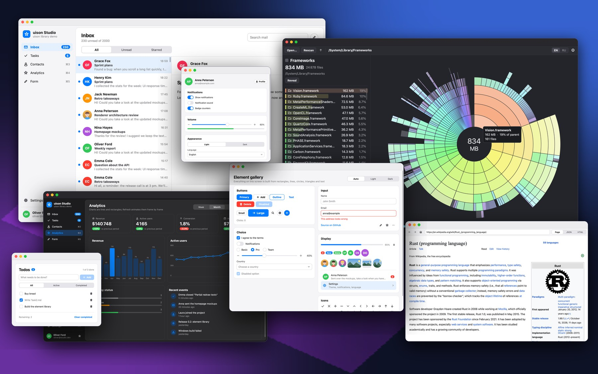

# uison

<!-- languages -->
<h3 align="center">
<a href="../../README.md">🇬🇧 English</a> ·
<b>🇨🇳 中文</b> ·
<a href="README.hi.md">🇮🇳 हिन्दी</a> ·
<a href="README.es.md">🇪🇸 Español</a> ·
<a href="README.fr.md">🇫🇷 Français</a> ·
<a href="README.ar.md">🇸🇦 العربية</a> ·
<a href="README.bn.md">🇧🇩 বাংলা</a> ·
<a href="README.pt.md">🇧🇷 Português</a> ·
<a href="README.ru.md">🇷🇺 Русский</a> ·
<a href="README.ur.md">🇵🇰 اردو</a> ·
<a href="README.id.md">🇮🇩 Bahasa Indonesia</a> ·
<a href="README.de.md">🇩🇪 Deutsch</a> ·
<a href="README.ja.md">🇯🇵 日本語</a> ·
<a href="README.mr.md">🇮🇳 मराठी</a> ·
<a href="README.te.md">🇮🇳 తెలుగు</a> ·
<a href="README.tr.md">🇹🇷 Türkçe</a> ·
<a href="README.uk.md">🇺🇦 Українська</a>
</h3>
<!-- /languages -->

**uison**（UI + JSON）是一个用 Rust 编写的小巧、快速的 UI 框架，完全没有任何依赖——只用标准库，
连 JSON 解析器都是自己写的。界面被描述为一棵元素树：可以写在 JSON 文件里，可以用 Rust DSL，
可以用 Flutter 风格的 C++ 组件（widget），也可以直接把 JSON 写进 C 代码。逻辑就是普通的 Rust、C
或 C++ 代码：事件处理函数、数据、线程。窗口、布局、绘制和输入由 uison 负责，同一个程序可以运行在
macOS、Windows、Linux（Wayland 和 X11）、iOS、Android 以及浏览器中。

每个后端都通过手写的 FFI 直接与系统交互：AppKit 和 CoreText，Win32 加 Direct2D 和 DirectWrite
（手写 COM），从零实现的 Wayland 协议和 X11，UIKit，通过 JNI 调用的 Android Canvas，以及
WebAssembly 中的 2D canvas。release 版程序只是一个约 0.7–0.9 MB 的文件，除系统自带的库之外不需要
任何东西；在桌面系统上，一个事件大约一毫秒就能反映到屏幕上。



## 工作原理

```text
界面（JSON、Rust DSL、C++ 组件、C 中的 UISON_JSON）  +  数据  +  用你的语言写的处理函数
        │  绑定、模板、主题、布局（uison-ui）
        ▼
由图元组成的帧：rect, line, circle, tri, poly, text, image, clip, hit
        │  与上一帧做 diff → 只重绘变化的部分
        ▼
系统后端：AppKit, Win32 + Direct2D, Wayland/X11 + Cairo, UIKit, Android Canvas, canvas 2D
```

界面会被编译成一个*帧*（frame）：由少数几种图元组成的扁平列表——矩形、线段、圆、多边形、单行文本、
图片、裁剪区域，以及供鼠标和触摸使用的不可见点击区域（hit area）。每一帧都会与上一帧比较，后端只重绘
发生变化的区域。后端之所以小巧，是因为它只需要绘制这些图元、测量文本，并把系统事件转换成 uison 的事件。

界面语言里没有代码。文本和属性绑定到数据（`"Pressed {@n} times"`、`"disabled": "!@form.valid"`），
元素是带参数、可复用的模板，颜色和尺寸来自主题 token，事件调用具名的动作（action），其处理函数用 Rust、C
或 C++ 编写。处理函数修改数据后，界面会自动重建。

## Hello, world

同一个窗口——一个计数器和一个“+1”按钮——分别用三种语言实现。

**Rust**——界面用 DSL 构建，处理函数是按钮上的闭包：

```rust
use uison::prelude::*;

fn main() {
    let screen = center(column().gap(12).cross("center").children([
        text("Pressed {@n} times").size(20),
        button("+1").key("inc").on_click(|cx| cx.data.edit("n", |n: &mut i32| *n += 1)),
    ]));
    let mut ui = Ui::from_node(screen).with_size(320.0, 200.0);
    ui.data.set("n", 0);
    run(ui, "Hello");
}
```

**C**——界面是直接写在代码里的 JSON，处理函数是一个普通函数：

```c
#include <uison_kit.h>

static void inc(uison_cx* cx, void* user) {
    (void)user;
    uison_data* d = uison_cx_data(cx);
    uison_data_set_f64(d, "n", uison_data_f64(d, "n") + 1);
}

int main(void) {
    uison_ui* ui = uison_ui_new(UISON_JSON({
        size: [320, 200],
        data: { n: 0 },
        root: { Center: { child: { Column: { gap: 12, cross: "center", children: [
            { Text: { text: "Pressed {@n} times", size: 20 } },
            { Button: { key: "inc", text: "+1", on: { click: "inc" } } },
        ] } } } }
    }));
    if (!ui) return uison_kit_fail(); /* prints the JSON error and where it is */
    UISON_ON(ui, inc);                /* action "inc" → function inc */
    return uison_run(ui, "Hello");
}
```

**C++**——Flutter 风格的组件，处理函数是按钮上的 lambda：

```cpp
#include <uison_widgets.hpp>

using namespace uison::widgets;

int main() {
    auto screen = Center({.child = Column({.gap = 12, .cross = "center", .children = {
        Text("Pressed {@n} times", {.size = 20}),
        Button("+1", {.key = "inc", .on_click = [](uison::Cx& cx) {
            cx.data().update<int>("n", [](int n) { return n + 1; });
        }}),
    }})});
    uison::Ui ui(screen, {.size = {320, 200}, .data = uison::obj{{"n", 0}}});
    return ui.run("Hello");
}
```

要开始自己的项目，请参阅 [Rust](../rust/quickstart.md)、[C](../c/quickstart.md) 或
[C++](../cpp/quickstart.md) 的快速入门。

## 特性

- **零依赖。** 核心、JSON 解析器、布局、Wayland 客户端、用于 Linux 设置门户（settings portal）的
  D-Bus 客户端以及 Windows 的 COM 绑定，全部在本项目中基于 `std` 编写。`Cargo.lock` 里只有
  workspace 自己的 crate。
- **一个程序，六个平台。** macOS、Windows（x64 和 ARM64）、Linux（Wayland 和 X11，arm64 和
  x86_64）、iOS、Android（arm64-v8a 和 armeabi-v7a）以及浏览器（WebAssembly）。在手机上，同样的
  代码会获得触摸、安全区域、屏幕键盘和惯性滚动。
- **局部重绘。** 对帧做 diff，只重绘受影响的区域；细线在所有后端上都以相同方式对齐到物理像素。
- **元素库**：按钮、图标按钮和 25 个图标、复选框、单选按钮、开关、滑块、下拉选择、标签页、支持选择和
  剪贴板的文本框、进度条、卡片、列表项、徽标、头像、提示框、上下文菜单、链接和图片。元素本身就是 JSON
  模板（`lib/*.json`），你自己的组件也以同样的方式编写。
- **Flutter 风格的布局**：`Row`、`Column`、`Stack`、`Wrap`、`Align`、flex、滚动、可容纳数万行的
  虚拟化列表，以及 `Flow`——由行内文本片段组成、可跨片段换行的段落。
- **绑定与状态**：数据路径（`@user.name`）、文本插值、组件的局部状态（`@~open`）、按状态（hover、
  pressed、focus）的选择器、`switch`，以及少量函数（`eq`、`not`、`len`、`ratio`…）。结构体与数据
  可以互相映射：Rust 中用 `#[derive(Data)]`，C 中用字段表，C++20 中用无需宏的反射。
- **主题**：浅色、深色和“跟随系统”，由可覆盖的 token 构建。
- **自定义绘制**：`Canvas` 节点会调用你的函数，把图元写入它的矩形区域，与普通元素并列。
- **线程**：工作线程把结果投递回 UI 线程（`post`），除浏览器外的所有平台都支持。
- **热重载**（仅 debug 构建）：设置 `UISON_RELOAD=folder` 后，保存界面的 JSON 文件时会重新读取。
- **无窗口测试**：场景脚本（`UISON_SCRIPT=scenario.json`）按元素的 `key` 点击、输入、滚动和截图；
  同一套场景可以在所有平台、headless Chrome、iOS 模拟器和手机上运行。
- **[智能体模式](../agents.md)**：LLM 智能体无需截图即可使用程序。它按含义读取屏幕（角色、名称、状态、key），
  并沿着与人工输入相同的路径点击、输入和选择，可用 JSON 行（`--agent`），也可作为 MCP 服务器（`--mcp`）。
- **C 和 C++ API**：`uison.h`（C99）、`uison_kit.h`（C 的辅助工具）、`uison.hpp`（C++17，C++20
  下更便捷）和 `uison_widgets.hpp`（由与 Rust DSL 相同的 schema 生成的 C++20 组件）；提供静态库和
  动态库、CMake 包以及 `pkg-config`。C 和 C++ 也可以用 Emscripten 构建到浏览器：
  `em++ main.cpp libuison.a -o index.html`。

## 平台

| 平台 | 后端 | 验证环境 |
|---|---|---|
| macOS | AppKit、CoreGraphics、CoreText、ImageIO，通过 Objective-C 运行时调用 | Apple Silicon Mac——主要开发机器 |
| iOS | UIKit、CADisplayLink，与 macOS 相同的 CoreGraphics/CoreText 代码 | 模拟器和 iPhone 12 mini |
| Android | 手写 JNI、`android.graphics.Canvas`、约 300 行的 Java 层；不用 Gradle 构建 APK | Huawei P40 lite（Android 10） |
| Windows | Win32、Direct2D、DirectWrite 和 WIC，手写 COM；按显示器 DPI（per-monitor DPI）、深色标题栏 | Windows 11 PC，缩放 100/125/150 %，以及两台缩放不同的显示器 |
| Linux | 自行实现的 Wayland 协议代码和 X11（xcb）、Cairo + Pango、xkbcommon——全部通过 `dlopen` 加载，因此二进制只依赖 libc | 无头（headless）的 Mutter、KWin、Sway、Weston 和 X11（arm64 和 x86_64）；虚拟机中带 GNOME 的 Ubuntu 24.04 |
| 浏览器 | `wasm32-unknown-unknown`，不用 wasm-bindgen，canvas 2D；C/C++ 通过 Emscripten | Chrome（以及 headless Chrome） |

尚未验证：Windows 上的真实触摸屏、Windows on ARM（能构建但还没运行过）、真实硬件上的 Linux 和 KDE、
GNOME 中的鼠标和键盘输入、Safari 和 Firefox。

## 体积与速度

release 构建（`opt-level = "s"`、LTO、`panic = "abort"`、去除符号）。体积数据来自项目在发展过程中
自己的测量，最新构建可能有几个百分点的差异。

| 程序 | 体积 |
|---|---|
| 第 1 课（上面的计数器），Rust，macOS | ~0.7 MB |
| 同一程序的 C / C++ 版，链接 `libuison.a`，macOS | 672 KB / 816 KB |
| Studio——主演示程序（含 2,000 封邮件的邮箱、看板、联系人、图表、表单），macOS | ~840 KB |
| Studio，Windows x64 / ARM64 | 672 KB / 613 KB，无需 Visual C++ Redistributable |
| Studio，Linux arm64 / x86_64 | 857 KB / 936 KB |
| Studio，Android `libmain.so` arm64 | ~820 KB |
| Studio，浏览器（`.wasm`，gzip） | ~220 KB |

| 测量项 | 结果 |
|---|---|
| 事件 → 窗口完成绘制，macOS | ~0.8 ms，其中 uison 自身的工作约 0.2 ms |
| 触摸 → 帧，iPhone 12 mini | 3.6 ms；列表滚动稳定在 60 fps |
| Studio 全量重绘，iPhone 12 mini / Huawei P40 lite | 0.7 ms / 0.4–0.7 ms |
| 鼠标事件 → 帧，Windows（Iris Xe，60 Hz） | p50 1.4–1.7 ms |
| 事件 → 帧，Chrome | 中位数 2.2 ms |
| 启动 → 第一帧 | iOS 37–41 ms，Android 58–68 ms，Windows 73–103 ms，浏览器 24–42 ms |

[Disk Usage](../../examples/disk-usage/README.md) 是一个 egui 程序的移植版，可以直接对比：在 macOS
arm64 上，二进制是 857 KB 而不是 5.1 MB，没有任何依赖（原版 `Cargo.lock` 中有 362 个 crate），
扫描速度和内存占用相同。

## 文档

文档为英文，每一页都有[俄文版本](../ru/README.md)。

- [选择语言](../README.md)——从哪里开始。
- 系列课程，每个系列都可以单独阅读，从配置系统到线程和自定义帧：
  [Rust](../rust/README.md)、[C](../c/README.md)、[C++](../cpp/README.md)。
  核心课程在三种语言中是同一个程序，截图逐像素一致。
- [界面语言](../screens/README.md)：[绑定与值](../screens/bindings.md)、
  [布局](../screens/layout.md)、[元素](../screens/elements.md)、
  [主题](../screens/themes.md)。
- [iOS 和 Android](../mobile.md)、[浏览器（WebAssembly）](../wasm.md)。

## 示例

| 示例 | 展示内容 |
|---|---|
| `studio` | 主演示程序：含 2,000 封邮件的邮箱、看板、联系人、带动画的图表、表单、设置；窄于 700 pt 时使用手机布局 |
| `gallery` | 元素库中的所有元素 |
| `disk-usage` | 一个 egui 应用的移植版：在 `Canvas` 节点中绘制的旭日图，面板和菜单是 uison 界面，基于 `std` 的并行扫描器 |
| `browser` | 一个小型网页浏览器：自己的 HTML 和 CSS 解析器与层叠（cascade）、HTTP，以及通过系统 TLS 的 HTTPS；页面被转换成 uison 界面 |
| `todo` | 用 Rust DSL 编写的待办列表 |
| `list10k` | 10,000 行的虚拟化列表 |
| `form2`, `settings` | 表单和设置界面 |
| `demo`, `scroll`, `uibench` | 手写图元、滚动、基准测试 |

```sh
cargo run --release -p studio
cargo run --release -p disk-usage -- ~/Downloads
cargo run --release -p browser
```

C 和 C++ 示例位于 [`examples-c`](../../examples-c) 和 [`examples-cpp`](../../examples-cpp)，
各自是独立的 CMake 项目。

## 构建与测试

只需要 stable 版 Rust；在 macOS、Windows（使用 MSVC 工具链）和 Linux 上不需要其他任何东西
（不需要 `-dev` 包：系统库在运行时加载）。各系统的环境配置是每个系列的第 0 课
（[Rust](../rust/lessons/00-setup.md)）。

```sh
cargo test --workspace && cargo clippy --workspace   # tests
cargo run --release -p studio                        # a window on macOS, Windows or Linux
tools/web.sh studio && python3 tools/serve.py target/web/studio 8000   # the browser
tools/ios.sh studio sim                              # iOS simulator (Xcode)
tools/android.sh studio                              # an APK without Gradle (Android SDK and NDK)
tools/c-dist.sh macos                                # the C/C++ package in dist/uison-macos
tools/lessons.sh                                     # build every lesson, run its scenario, update the screenshots
```

在 Windows 上脚本是 `tools\*.ps1`：`tools\win.ps1 studio` 负责构建、运行场景并保存截图，
`tools\c-dist.ps1 -Test` 构建并测试 C/C++ 包。

用于调试的后端开关，在所有平台上都一样：`UISON_STATS=1` 打印事件、帧和动画的耗时，`UISON_FLASH=1`
高亮显示重绘的区域，`UISON_SCRIPT` / `UISON_CAPTURE` 运行场景并保存截图。

## 目录结构

```
crates/
  uison-json      JSON pull 解析器和值树，支持注释、尾随逗号和不带引号的键
  uison-core      几何、颜色、字体、事件，Canvas 和 Host trait，App trait
  uison-frame     图元帧：解析、diff → 损坏区域、点击测试、场景执行器
  uison-ui        界面编译器：模板、绑定、主题、布局、运行时、Rust DSL、lib/*.json
  uison-apple     macOS 和 iOS 共用：Objective-C FFI、CoreGraphics、CoreText、ImageIO
  uison-macos     AppKit 后端
  uison-ios       UIKit 后端
  uison-android   JNI 后端及其 Java 层（java/dev/uison）
  uison-windows   Win32 + Direct2D + DirectWrite 后端
  uison-linux     Wayland 和 X11 后端，Cairo + Pango，全部通过 dlopen
  uison-web       WebAssembly 后端（crates/uison-web/uison.js）
  uison-c         C API 和 C++ 头文件，静态库和动态库，CMake 包
  uison-gen       根据界面 schema 生成 C++ 组件、Rust DSL 和元素参考
  uison-derive    #[derive(Data)]，不依赖 syn
  uison           总括 crate：当前平台的一切，uison::prelude；Rust 课程
examples/         Rust 示例（见上文）
examples-c/       C 示例和课程，CMake 项目
examples-cpp/     C++ 示例和课程，CMake 项目
scenarios/        所有平台共用的测试场景
tools/            各平台的构建、运行和测试脚本；真实鼠标和键盘输入的驱动程序
web/              WebAssembly 后端的页面和 JavaScript 部分
docs/             英文文档；ru/ 为相同内容的俄文版；readme/ 为本 README 的其他语言版本
```

## 局限

- 每个程序只有一个窗口；不支持拖放。
- 文本输入支持拉丁字母、西里尔字母和手机的屏幕键盘；桌面上的中文、日文和韩文组合输入（IME）尚未实现，
  从右到左的文本也尚未支持。
- 目前还不支持无障碍功能（屏幕阅读器）。
- 浏览器中没有线程。
- 框架还很年轻：版本 0.1，API 可能会变化。

## 翻译

文档为英文，`docs/ru/` 中有相同页面的俄文版，每页顶部都有语言切换。本 README 也有翻译：
`docs/readme/README.<code>.md`，每种语言一个文件，每个文件顶部都有语言列表。这里的改动也应同步到各个翻译中。

## 许可证

许可证尚未确定。
