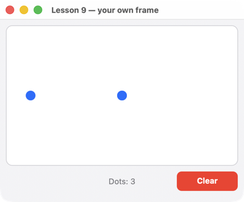

# uison на ассемблере

[English](../asm.md) · **Русский**

У uison простой C API ([`uison.h`](../../crates/uison-c/include/uison.h)), поэтому им может пользоваться любой язык, который умеет вызывать функции C, — и ассемблер тоже. В [`examples-asm/`](../../examples-asm) — два урока из [серии на C](c/README.md), переписанные вручную:

| урок | что показывает | x86-64 (NASM) | AArch64 (GNU as) |
|---|---|---|---|
| [1. Окно и кнопка](c/lessons/01-hello.md) | экран — строка JSON в секции данных, действие `inc` — функция-обработчик | [`x64.asm`](../../examples-asm/lessons/01-hello/x64.asm) | [`arm64.S`](../../examples-asm/lessons/01-hello/arm64.S) |
| [9. Свой кадр](c/lessons/09-frame.md) | без языка экранов: программа сама пишет кадр из примитивов в буфер и сама обрабатывает мышь | [`x64.asm`](../../examples-asm/lessons/09-frame/x64.asm) | [`arm64.S`](../../examples-asm/lessons/09-frame/arm64.S) |

Это те же программы, что на C, C++ и Rust, и их снимки совпадают до пикселя на Windows (x86-64) и macOS (Apple Silicon): `tools\lessons-compare.ps1`, `tools/lessons-compare.sh`.

 

## Какой файл для какой системы

- **`x64.asm`** — NASM, синтаксис Intel. Один исходник покрывает оба соглашения вызова x86-64: Windows x64 (`nasm -f win64`) и System V для Linux (`-f elf64`) и macOS на Intel (`-f macho64 --gprefix _`). Различия — несколько макросов в начале файла и `%ifdef WIN64` там, где в вызов передаётся `double`.
- **`arm64.S`** — синтаксис GNU as через компилятор C (`cc -c arm64.S`, поэтому сначала работает препроцессор C). Один исходник покрывает macOS (Apple Silicon) и Linux (AArch64, например Raspberry Pi). Соглашение вызова у них одинаковое, поэтому отличаются только имена и адреса: `SYM(main)` на macOS превращается в `_main`, `addr x0, label` — в `adrp` и `@PAGEOFF` или `:lo12:`, а `L(name)` делает метку локальной для файла.

Windows на ARM не покрыт: у его ассемблера (`armasm64`) другой синтаксис.

Соглашения вызова коротко:

| | целые и указатели | аргументы `double` | сохраняемые регистры | стек при `call` |
|---|---|---|---|---|
| Windows x64 | `rcx rdx r8 r9`, дальше стек | регистр по позиции аргумента: третий аргумент — в `xmm2` | `rbx rbp rdi rsi r12–r15` | выровнен на 16 байт, плюс 32 байта теневой области для вызываемой функции |
| System V x86-64 | `rdi rsi rdx rcx r8 r9`, дальше стек | `xmm0`–`xmm7`, счёт отдельный | `rbx rbp r12–r15` | выровнен на 16 байт |
| AArch64 (AAPCS64) | `x0`–`x7` | `d0`–`d7`, счёт отдельный | `x19`–`x28`, `d8`–`d15` | выровнен на 16 байт |

Результат возвращается в `rax`/`xmm0` (x86-64) или в `x0`/`d0` (AArch64). `bool` занимает один байт; в аргументе обнуляйте регистр целиком.

## Как устроены уроки

**Урок 1.** `main` передаёт JSON экрана в `uison_ui_new`, связывает действие `"inc"` с функцией `inc` вызовом `uison_ui_on(ui, "inc", inc, NULL, NULL)` и открывает окно через `uison_run`. При щелчке uison вызывает `inc(cx, user)`. Обработчик берёт данные через `uison_cx_data`, читает `n` через `uison_data_f64` и записывает `n + 1` через `uison_data_set_f64`. Экран перерисовывается сам, потому что текст `Pressed {@n} times` привязан к `n`.

**Урок 9.** Языка экранов здесь нет. `main` передаёт в `uison_run_app` структуру `uison_app`: шесть полей по 8 байт (`size`, `user`, `frame`, `on_event`, `wants_tick_us`, `drop`), записанных через `dq`/`.quad`. `frame` и `on_event` возвращают кадр — строку JSON вида `{ size: [400, 300], items: [{ rect: […] }, { circle: [x, y, 8], fill: "#007AFF" }, { hit: […], id: "clear" }] }`. Программа собирает эту строку в буфере на 8 КБ двумя помощниками: `put` дописывает строку, `num` — число через `uison_json_number`, которая выдаёт кратчайшую запись и обходится без `printf`. События тоже приходят в JSON (`{"type":"down","x":120,"y":80,"button":"left"}`), и чтобы их разобрать, хватает `strstr` и `strtod` из libc. `uison_host_measure` даёт ширину надписи «Dots: N», чтобы поставить её по центру.

Функции C с переменным числом аргументов (`printf`, `uison_fmt`, `uison_data_setf`) не используются намеренно: правила их вызова различаются между системами. На macOS с Apple Silicon такие аргументы передаются через стек.

## Сборка

Нужны ассемблер, компилятор C (он линкует программу и добавляет рантайм C, который вызывает `main`), CMake и сама библиотека: собранная из исходников (Rust) или готовый пакет `dist/uison-<платформа>`. Как всё это поставить, рассказано в [уроке 0 по C](c/lessons/00-setup.md). Для x86-64 нужен ещё [NASM](https://www.nasm.us): `winget install NASM.NASM`, `sudo apt install nasm` или `brew install nasm`.

```sh
cmake -S examples-asm -B out/asm -DUISON_PACKAGE=/путь/к/uison-<платформа>   # без UISON_PACKAGE — из исходников
cmake --build out/asm --config Release
```

CMake выбирает файл по процессору (`x64.asm` или `arm64.S`) и собирает `asm-01-hello` и `asm-09-frame`. На Windows (генератор Visual Studio) программы лежат в `out/asm/Release`.

Без CMake, из пакета (`$D` — папка пакета):

```sh
# Windows x64, в «x64 Native Tools Command Prompt»: через DLL (uison.dll положить рядом с программой)
nasm -f win64 x64.asm -o hello.obj
link hello.obj %D%\lib\uison.dll.lib msvcrt.lib ucrt.lib vcruntime.lib

# Linux x86-64
nasm -f elf64 x64.asm -o hello.o
cc hello.o $D/lib/libuison.a -lgcc_s -lutil -lrt -lpthread -lm -ldl -Wl,--gc-sections -o hello

# Linux AArch64
cc arm64.S $D/lib/libuison.a -lgcc_s -lutil -lrt -lpthread -lm -ldl -Wl,--gc-sections -o hello

# macOS (Apple Silicon)
cc arm64.S $D/lib/libuison.a -framework AppKit -framework CoreGraphics -framework CoreText -framework ImageIO \
  -framework CoreFoundation -framework Foundation -lobjc -Wl,-dead_strip -o hello
```

Для `link` библиотеки рантайма C нужно перечислить явно: `cl` вписывает «подключить рантайм C» в каждый объектный файл, который компилирует, а NASM — нет. Статической `uison.lib` нужны ещё системные библиотеки из `UISON_SYSTEM_LIBS` в [`uison-libs.cmake`](../../crates/uison-c/cmake/uison-libs.cmake). CMake добавляет их сам.

Проверка — как у остальных уроков: `UISON_SCRIPT=scenarios/lessons/hello.json` нажимает кнопку, а `UISON_CAPTURE=папка` сохраняет снимок. На Windows `tools\lessons.ps1 asm` собирает и запускает оба урока, а `tools\c-dist.ps1 -Test` проверяет их с пакетом, если установлен NASM. На Mac `tools/lessons.sh asm` собирает оба урока из `arm64.S` и прогоняет их сценарии (снимки в `out/lessons/asm`), а `tools/lessons-compare.sh` сравнивает их с Rust, C и C++.
