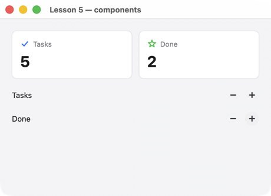

# Урок 5. Экран из файлов

[English](../../../c/lessons/05-files.md) · **Русский**

**Что будет:** экран и свои элементы — JSON-файлы рядом с программой: две карточки-счётчика и строки с кнопками «−» и «+». Файлы можно править, пока программа работает.



<!-- code: examples-c/lessons/05-files/main.c -->
```c
/* Lesson 5: custom components. The screen and the components are files next to the program
   (CMake copies them into the build folder); one handler for several buttons, told apart by key. */
#include <stdio.h>
#include <string.h>

#include <uison.h>

/* The button key: "inc-Tasks" / "dec-Done" → the path in data. */
static const char* path_of(const char* key) {
    return strstr(key, "Tasks") ? "tasks" : "done";
}

static void change(uison_cx* cx, void* user) {
    int step = *(const int*)user;
    uison_data* d = uison_cx_data(cx);
    const char* p = path_of(uison_cx_key(cx));
    double v = uison_data_f64(d, p) + step;
    uison_data_set_f64(d, p, v < 0 ? 0 : v);
}

int main(void) {
    uison_ui* ui = uison_ui_load("screen.json");
    if (!ui || !uison_ui_load_components(ui, "components.json")) {
        fprintf(stderr, "%s\n", uison_last_error());
        return 1;
    }
    static const int plus = 1, minus = -1;
    uison_ui_on(ui, "inc", change, (void*)&plus, NULL);
    uison_ui_on(ui, "dec", change, (void*)&minus, NULL);
    return uison_run(ui, "Lesson 5 — components");
}
```

Экран — `screen.json`:

<!-- code: examples-c/lessons/05-files/screen.json -->
```js
// The lesson 5 screen: custom components Stat and Counter from components.json.
{
  size: [460, 300],
  data: { tasks: 3, done: 1 },
  root: { Column: { padding: 20, gap: 16, cross: "stretch", children: [
    { Row: { gap: 12, children: [
      { Stat: { title: "Tasks", value: "@tasks", icon: "check" } },
      { Stat: { title: "Done", value: "@done", icon: "star", color: "$theme.success" } },
    ] } },
    { Counter: { label: "Tasks" } },
    { Counter: { label: "Done" } },
  ] } }
}
```

Свои компоненты — `components.json`:

<!-- code: examples-c/lessons/05-files/components.json -->
```js
// Custom components: params are the parameters with default values, body is the tree,
// inside it parameters are $name. The screen uses them like built-in ones: { Stat: { title: … } }.
{
  Stat: {
    params: { title: "", value: 0, icon: "star", color: "$theme.primary" },
    body: {
      Box: {
        flex: 1, padding: 14, radius: "$theme.radius", fill: "$theme.card", stroke: "$theme.divider",
        child: { Column: { gap: 6, children: [
          { Row: { gap: 6, cross: "center", children: [
            { Icon: { name: "$icon", size: 16, color: "$color" } },
            { Text: { text: "$title", size: 12, color: "$theme.muted" } },
          ] } },
          { Text: { text: "$value", size: 26, bold: true } },
        ] } },
      },
    },
  },

  // The button keys are built from a parameter ("inc-{$label}"): each Counter has its own buttons,
  // while the handler is one; it tells which was pressed by the key.
  Counter: {
    params: { label: "" },
    body: {
      Row: { gap: 8, cross: "center", children: [
        { Text: { text: "$label", flex: 1 } },
        { IconButton: { icon: "minus", size: "sm", key: "dec-{$label}", on: { click: "dec" } } },
        { IconButton: { icon: "plus", size: "sm", key: "inc-{$label}", on: { click: "inc" } } },
      ] },
    },
  },
}
```

## Как это работает

1. **Файлы рядом с программой.** `uison_ui_load("screen.json")` ищет файл рядом с программой, затем в текущей папке; `uison_ui_load_components` — так же. CMake кладёт их к программе (`uison_web_files` в [`examples-c/CMakeLists.txt`](../../../../examples-c/CMakeLists.txt)); в браузере — в файловую систему страницы.
2. **Живая перезагрузка.** `UISON_RELOAD=folder` — экран и компоненты читаются из этой папки (файлы с теми же именами) и перестраиваются при сохранении, данные сохраняются. Работает на компьютере (macOS, Windows, Linux):

   ```sh
   UISON_RELOAD=examples-c/lessons/05-files ./out/c/build/c-05-files
   ```

   Поменяйте подпись или цвет в `screen.json`, сохраните — окно обновится.
3. **Свои компоненты.** `Stat` и `Counter` — шаблоны: `params` (параметры со значениями по умолчанию) и `body` (дерево, параметры внутри — `$name`). В экране они используются как встроенные ([справочник](../../screens/bindings.md#параметры-компонента-param)).
4. **Один обработчик, разные `user`.** `uison_ui_on(ui, "inc", change, &plus, NULL)` и `(ui, "dec", change, &minus, NULL)` — одна функция с разным шагом. Какая строка — по key кнопки: `"inc-{$label}"` → `inc-Tasks`.
5. **Большие экраны** — в файлах: правятся без пересборки, подсвечиваются редактором как JSON, а длина не упирается в пределы строковых литералов компилятора.

## Попробуйте

- Добавьте в `components.json` компонент `Progress` (полоса по `value` и `max`) и покажите его под счётчиками — не пересобирая программу.
- Положите экран рядом в одном файле: `components` прямо в `screen.json`.

Дальше — [урок 6: темы и токены](06-themes.md).
