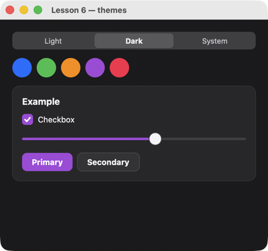

# Урок 6. Темы и токены

[English](../../../c/lessons/06-themes.md) · **Русский**

**Что будет:** вкладки «Light / Dark / System» и пять кружков-цветов: выбор перекрашивает флажок, ползунок и кнопку.



<!-- code: examples-c/lessons/06-themes/main.c -->
```c
/* Lesson 6: themes and tokens. Element colors are theme tokens ($theme.primary, $theme.card…);
   uison_cx_set_theme changes the theme, uison_cx_set_token a single token. */
#include <stdlib.h>
#include <string.h>

#include <uison_kit.h>

static void theme(uison_cx* cx, void* user) {
    (void)user;
    uison_cx_set_theme(cx, uison_data_str(uison_cx_data(cx), "theme"));
}

static void accent(uison_cx* cx, void* user) {
    /* key "accent-#34C759" → the color after the dash; the token value is JSON: a quoted string (uison_fmt). */
    const char* color = strrchr(uison_cx_key(cx), '-') + 1;
    char* json = uison_fmt("%s", color);
    (void)user;
    uison_cx_set_token(cx, "primary", json);
    uison_data_set_str(uison_cx_data(cx), "accent", color);
    free(json);
}

int main(void) {
    uison_ui* ui = uison_ui_new(UISON_JSON({
        size: [440, 380],
        data: { theme: "light", accent: "#007AFF", agree: true, volume: 60,
                accents: ["#007AFF", "#34C759", "#FF9500", "#AF52DE", "#FF2D55"] },
        root: { Column: { padding: 20, gap: 14, cross: "stretch", children: [
            { Tabs: { key: "theme", value: "@theme", on: { change: "theme" },
                      tabs: [{ value: "light", label: "Light" }, { value: "dark", label: "Dark" }, { value: "system", label: "System" }] } },
            { Row: { gap: 8, children: [ { For: { each: "@accents", as: "c", do: {
                Box: { key: "accent-{@c}", w: 32, h: 32, radius: 16, fill: "@c", on: { click: "accent" } } } } } ] } },
            { Card: { title: "Example", children: [
                { Checkbox: { label: "Checkbox", checked: "@agree" } },
                { Slider: { value: "@volume", min: 0, max: 100 } },
                { Row: { gap: 8, children: [ { Button: { text: "Primary" } }, { Button: { text: "Secondary", variant: "secondary" } } ] } },
            ] } },
        ] } }
    }));
    if (!ui) return uison_kit_fail();
    uison_ui_set_theme(ui, "light");
    UISON_ON(ui, theme);
    UISON_ON(ui, accent);
    return uison_run(ui, "Lesson 6 — themes");
}
```

## Как это работает

1. **Токены.** Элементы библиотеки берут цвета из токенов темы: `$theme.primary`, `$theme.card`, `$theme.text`… Сменили тему — перекрасилось всё ([themes.md](../../screens/themes.md)).
2. **Тема целиком.** `uison_cx_set_theme(cx, "dark")` в обработчике, `uison_ui_set_theme(ui, "light")` до запуска. `"system"` — как в системе, и экран сам переключится, когда пользователь сменит тему ОС.
3. **Один токен.** `uison_cx_set_token(cx, "primary", value)` меняет главный цвет поверх темы. Значение — JSON: строка в кавычках `"\"#AF52DE\""`. `uison_fmt("%s", color)` собирает её без экранирования руками (строку освободить — `free`).
4. **Цвет из данных.** `fill: "@c"` у кружка — привязка: цвет — элемент массива `accents`.
5. **Вкладки.** `Tabs { value: "@theme", tabs: [{ value, label }…] }` пишет выбор в `theme`, `on: { change: "theme" }` вызывается после.

## Попробуйте

- Запоминать выбор между запусками: записать тему в файл в обработчике `theme` и прочитать при старте.
- `uison_cx_set_token(cx, "radius", "2")` — все элементы почти квадратные.

Дальше — [урок 7: картинки, подсказки, меню](07-rich.md).
