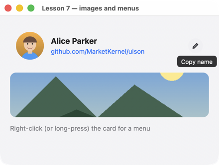
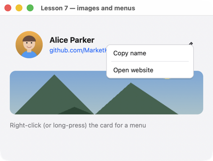

# Урок 7. Картинки, подсказки, меню

[English](../../../c/lessons/07-rich.md) · **Русский**

**Что будет:** карточка с фото, ссылкой и кнопкой с подсказкой; правой кнопкой (долгим нажатием на телефоне) — меню; ниже — картинка.





<!-- code: examples-c/lessons/07-rich/main.c -->
```c
/* Lesson 7: images, tooltips, a context menu, links, the clipboard. Everything except images
   is just properties in JSON; an image is given as a file (PNG or JPEG) or as bytes. */
#include <uison_kit.h>

static void copy(uison_cx* cx, void* user) {
    (void)user;
    uison_cx_copy(cx, "Alice Parker");
    uison_data_set_str(uison_cx_data(cx), "status", "Name copied to clipboard");
}

static void site(uison_cx* cx, void* user) {
    (void)user;
    uison_cx_open_url(cx, "https://github.com/MarketKernel/uison");
}

int main(void) {
    uison_ui* ui = uison_ui_new(UISON_JSON({
        size: [440, 300],
        data: { status: "Right-click (or long-press) the card for a menu" },
        root: { Column: { padding: 20, gap: 14, cross: "stretch", children: [
            { Row: {
                key: "card", gap: 14, cross: "center", padding: 12,
                // Context menu: label, action; "-" is a separator. uison_cx_key is the node it was opened on.
                contextMenu: [{ label: "Copy name", action: "copy" }, "-", { label: "Open website", action: "site" }],
                children: [
                    { Avatar: { name: "Alice Parker", src: "@photo", size: 56 } },
                    { Column: { gap: 4, flex: 1, children: [
                        { Text: { text: "Alice Parker", bold: true, size: 16 } },
                        { Link: { text: "github.com/MarketKernel/uison", href: "https://github.com/MarketKernel/uison" } },
                    ] } },
                    // Tooltip: on any node (appears after half a second of hovering).
                    { IconButton: { key: "copy", icon: "edit", tooltip: "Copy name", on: { click: "copy" } } },
                ] } },
            // Image: the size is given or natural (one side given, the other keeps the aspect ratio);
            // fit: cover (crop), contain (fit inside), fill (stretch).
            { Image: { src: "@landscape", h: 90, fit: "cover", radius: 12 } },
            { Text: { text: "@status", color: "$theme.muted" } },
        ] } }
    }));
    if (!ui) return uison_kit_fail();
    /* An image from a file next to the program → source "mem:photo"; from memory — uison_ui_image. */
    const char* photo = uison_ui_image_file(ui, "photo", "photo.jpg");
    const char* landscape = uison_ui_image_file(ui, "landscape", "landscape.png");
    if (!photo || !landscape) return uison_kit_fail();
    uison_data_set_str(uison_ui_data(ui), "photo", photo);
    uison_data_set_str(uison_ui_data(ui), "landscape", landscape);
    UISON_ON(ui, copy);
    UISON_ON(ui, site);
    return uison_run(ui, "Lesson 7 — images and menus");
}
```

## Как это работает

1. **Картинки.** `uison_ui_image_file(ui, "photo", "photo.jpg")` читает PNG или JPEG рядом с программой и возвращает источник `"mem:photo"`; его кладут в данные и привязывают: `Avatar { src: "@photo" }`, `Image { src: "@landscape" }`. Из памяти — `uison_ui_image(ui, name, bytes, length)`. Файла нет — `NULL` и ошибка в `uison_last_error`.
2. **Размер картинки.** Задан один размер (`h: 90`) — второй по пропорции; `fit: "cover"` обрезает, `"contain"` вписывает, `"fill"` растягивает; `radius` скругляет углы.
3. **Подсказка.** `tooltip: "…"` у любого узла: через полсекунды наведения, на телефоне — по долгому нажатию.
4. **Контекстное меню.** `contextMenu: [{ label, action }, "-", …]` — пункт вызывает действие по имени, `uison_cx_key` — узел, на котором открыли меню.
5. **Ссылка.** `Link { text, href }` открывает адрес в браузере; из кода — `uison_cx_open_url`.
6. **Буфер обмена.** `uison_cx_copy(cx, "…")` — в системный буфер; вставка в поля ввода работает сама.

## Попробуйте

- Картинку, встроенную в программу: массив байтов (`xxd -i photo.jpg > photo.h`) и `uison_ui_image`.
- Аватар без фото: уберите `src` — останутся инициалы на цветном кружке.

Дальше — [урок 8: потоки](08-threads.md).
