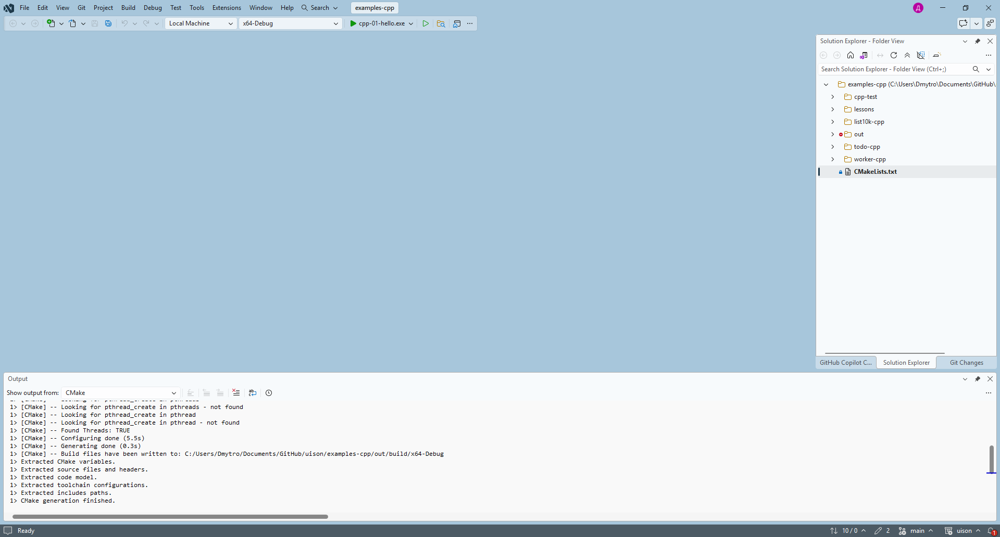
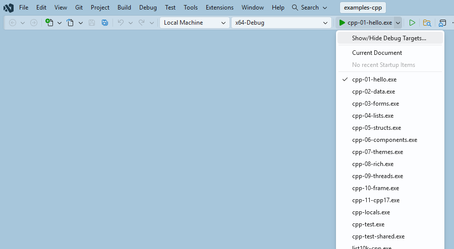
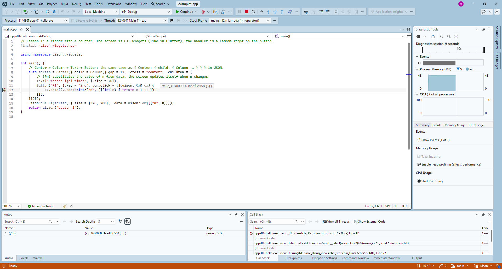

# Урок 0. Подготовка системы

[English](../../../cpp/lessons/00-setup.md) · **Русский**

**Что будет:** компилятор C++20, CMake и библиотека uison на вашей машине; в конце — урок 1.

Нужно:
- **компилятор C++20** — Apple clang из Xcode 15 и новее (macOS), GCC 11+ или clang 14+ (Linux), MSVC из Visual Studio 2022 или 2026 (Windows). Виджеты (`uison_widgets.hpp`) — C++20: назначенные инициализаторы; основа (`uison.hpp`) работает и с C++17 ([урок 11](11-cpp17.md));
- **CMake** 3.19 или новее — собирает уроки и вашу программу;
- **библиотека uison** — её собирает **Rust** из исходников (CMake вызывает его сам), или скачайте **готовый пакет** — тогда Rust не нужен;
- **git** — забрать исходники.

Библиотеки для окон, графики и шрифтов ставить не нужно: uison берёт их у системы.

## macOS

1. Компилятор и git — инструменты командной строки Apple:

   ```sh
   xcode-select --install
   ```

   Если стоит Xcode — они уже есть. Xcode целиком нужен только для iPhone ([урок 12](12-build.md)).
2. CMake: `brew install cmake` ([Homebrew](https://brew.sh)) или `.dmg` с [cmake.org](https://cmake.org/download/) (тогда в терминале — `sudo "/Applications/CMake.app/Contents/bin/cmake-gui" --install`).
3. Rust (собирает библиотеку):

   ```sh
   curl --proto '=https' --tlsv1.2 -sSf https://sh.rustup.rs | sh
   ```

   Enter — установка по умолчанию; потом новое окно терминала.

## Linux

| дистрибутив | команда |
|---|---|
| Ubuntu 22.04+, Debian 12+, Mint | `sudo apt install build-essential cmake curl git` (GCC 11+) |
| Fedora | `sudo dnf install gcc cmake curl git` |
| Arch, Manjaro | `sudo pacman -S --needed base-devel cmake curl git` |
| openSUSE | `sudo zypper install gcc cmake curl git` |

Затем Rust — так же, как на macOS. Пакеты `-dev` (Wayland, X11, Cairo, Pango) не нужны: uison загружает эти библиотеки во время работы, программа зависит только от libc. Нужен рабочий стол с Wayland или X11.

## Windows

> Раздел «Visual Studio» проверен вживую с Visual Studio 2026 (открыть папку, цель запуска, отладка — снимки ниже); саму установку на чистой Windows ещё не проходили.

1. **Visual Studio Community** (бесплатно; 2026, подойдёт и 2022): [visualstudio.microsoft.com](https://visualstudio.microsoft.com/ru/downloads/). В установщике на вкладке «Рабочие нагрузки» отметьте **«Разработка классических приложений на C++»**. В неё входят компилятор MSVC, Windows SDK и CMake — отдельно их ставить не нужно. Около 7 ГБ.
2. **Git**: [git-scm.com](https://git-scm.com/download/win) или `winget install Git.Git`.
3. **Rust**: [rustup-init.exe](https://rustup.rs) — Enter (установка по умолчанию). Visual Studio уже стоит, поэтому установщик сразу найдёт MSVC.
4. Откройте новое окно терминала — чтобы подхватились пути. Команды `cl` и `cmake` доступны в **«Командной строке разработчика для VS»** (меню «Пуск»; у VS 2022 в конце названия «2022»), а в Visual Studio — сразу.

### Visual Studio

Visual Studio открывает проект CMake без `.sln`:

1. **Файл → Открыть → Папку…** — папка с `CMakeLists.txt` (для уроков — `examples-cpp` из репозитория uison). Visual Studio сама запустит CMake; первый раз CMake вызовет cargo и соберёт библиотеку — минута-две, ход виден в окне «Вывод».

   

2. На панели инструментов — конфигурация (**x64-Debug** создаётся сама; другие — в `CMakeSettings.json` или `CMakePresets.json`) и **«Выбрать элемент запуска»** — программа, например `cpp-01-hello.exe` (сначала Visual Studio сама берёт первую программу списка).

   

3. **F5** — собрать и запустить под отладчиком, **Ctrl+F5** — без него. Точка останова в лямбде кнопки (урок 1) срабатывает при нажатии: видно `cx`, данные, стек. IntelliSense подсказывает поля виджетов с описаниями.

   

4. Программа — в `out\build\x64-Debug\` внутри папки проекта.
5. Кириллица в строках: исходники uison — UTF-8, компилятору нужен ключ `/utf-8` (в уроках он уже есть в `CMakeLists.txt`).

Второй путь — без Visual Studio-IDE: «Командная строка разработчика» и одна команда `cl` ([урок 12](12-build.md#windows-одной-командой)).

## Готовый пакет вместо Rust

Если Rust ставить не хочется: в релизах репозитория (`nightly` или версия) лежат пакеты `uison-macos`, `uison-linux-x86_64`, `uison-windows-x64`… Распакуйте и укажите CMake путь:

```sh
cmake -S examples-cpp -B build -DUISON_PACKAGE=/path/to/uison-macos
```

## Редактор

- **Visual Studio** (Windows) — см. выше.
- **VS Code** + расширения **C/C++** (или **clangd**) и **CMake Tools**: «CMake: Select Kit» (компилятор), «CMake: Build», F5.
- **CLion** — открывает `CMakeLists.txt` как проект.

## Проверка

```sh
c++ --version       # Windows: cl (in the "Developer Command Prompt")
cmake --version     # 3.19 or newer
rustc --version     # not needed if you took a prebuilt package
git --version
```

Урок 1 из репозитория uison:

```sh
git clone https://github.com/MarketKernel/uison
cd uison
cmake -S examples-cpp -B out/cpp/build -DCMAKE_BUILD_TYPE=Release
cmake --build out/cpp/build --target cpp-01-hello --config Release
./out/cpp/build/cpp-01-hello      # Windows: out\cpp\build\Release\cpp-01-hello.exe
```

Откроется окно с кнопкой «+1».


Что-то не так:
- `Could not find UISON_CARGO` — Rust не поставлен или окно терминала открыто до установки; либо возьмите готовый пакет (`-DUISON_PACKAGE=…`);
- `No CMAKE_CXX_COMPILER could be found` — нет компилятора: на macOS — `xcode-select --install`, на Linux — `build-essential` / `gcc`, на Windows — нагрузка «Разработка классических приложений на C++»;
- окно не открылось на Linux, в терминале ошибка `Wayland: …` — программа запущена без рабочего стола (по SSH, в контейнере).

Дальше — [урок 1: окно и кнопка](01-hello.md).
