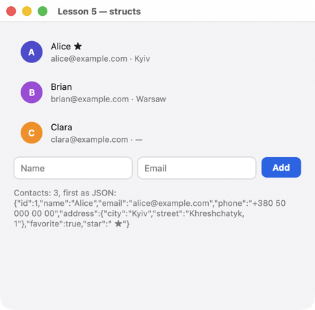

# Урок 5. Данные как структуры

[English](../../../cpp/lessons/05-structs.md) · **Русский**

**Что будет:** контакты из структур с вложенным адресом и необязательным телефоном; форма добавляет новый; всё состояние экрана — тоже структура.



<!-- code: examples-cpp/lessons/05-structs/main.cpp -->
```cpp
// Lesson 5 (C++20): data as structs. set/push/get understand any aggregate: fields, their names
// and nested structs are found automatically (no macros); plus vector, optional, map.
// The whole screen state is a struct too: {.data = State{…}}.
#include <optional>
#include <string>
#include <vector>

#include <uison_widgets.hpp>

using namespace uison::widgets;

struct Address {
    std::string city;
    std::string street;
};

struct Contact {
    int id = 0;
    std::string name;
    std::string email;
    std::optional<std::string> phone; // null in data when absent
    Address address;
    bool favorite = false;
};

struct Form {
    std::string name;
    std::string email;
};

// The whole screen state: fields are paths in data (form.name, contacts.0.email…).
struct State {
    std::vector<Contact> contacts = {};
    Form form = {};
    std::string summary = {};
};

int main() {
    auto add = [](uison::Cx& cx) {
        auto d = cx.data();
        auto f = d.get<Form>("form"); // data → struct
        if (f.name.empty()) return;
        int id = int(d.len("contacts")) + 1;
        d.push("contacts", Contact{id, f.name, f.email, std::nullopt, {"—", ""}}); // struct → data
        d.set("form", Form{});
    };
    auto screen = Column({.padding = 20, .gap = 12, .cross = "stretch", .children = {
        For({.each = "@contacts", .as = "c", .item = ListTile("{@c.name}{@c.star}", {
            .subtitle = "{@c.email} · {@c.address.city}", .leading = Avatar("@c.name", {.size = 32})})}),
        Row({.gap = 8, .children = {
            TextField({.value = "@form.name", .placeholder = "Name", .flex = 1, .key = "name"}),
            TextField({.value = "@form.email", .placeholder = "Email", .flex = 1, .key = "email"}),
            Button("Add", {.key = "add", .on_click = add}),
        }}),
        Text("@summary", {.size = 12, .color = "$theme.muted"}),
    }});
    State start{.contacts = {{1, "Alice", "alice@example.com", "+380 50 000 00 00", {"Kyiv", "Khreshchatyk, 1"}, true},
                             {2, "Brian", "brian@example.com", std::nullopt, {"Warsaw", "Nowy Swiat, 2"}}}};
    uison::Ui ui(screen, {.size = {460, 420}, .data = start});
    // Derived data: the star on favorites comes from structs read from data.
    ui.derive([](uison::Data& d) {
        auto contacts = d.get<std::vector<Contact>>("contacts");
        for (std::size_t i = 0; i < contacts.size(); i++)
            d.set("contacts." + std::to_string(i) + ".star", contacts[i].favorite ? " ★" : "");
        d.set("summary", "Contacts: " + std::to_string(contacts.size()) + ", first as JSON: " + d.json("contacts.0"));
    });
    return ui.run("Lesson 5 — structs");
}
```

## Как это работает

1. **Структуры без макросов.** `set`, `push`, `get<T>` понимают любые агрегаты: число полей, их имена и типы находятся сами (C++20). Поддерживаются вложенные структуры, `std::vector`, `std::map<std::string, T>`, `std::optional` (`null` в данных, если пусто).
2. **Состояние экрана — структура.** `{.data = State{…}}` — начальные данные экрана из структуры: поля `State` становятся путями (`contacts.0.email`, `form.name`).
3. **Где объявлять.** Структура — в пространстве имён (не внутри функции): рефлексии нужна внешняя связь.
4. **Своё преобразование.** Не агрегат (класс с приватными полями) — специализация `uison::convert<T>` с `write` (и `read` для `get<T>`).
5. **Производные из структур.** `derive` читает `std::vector<Contact>` и пишет в данные звёздочки и сводку — экран привязан к ним.

## Попробуйте

- Поле «Phone»: `std::optional<std::string>` заполняется, только если поле не пустое.
- Отметка «Favorite» у каждого контакта: `Checkbox` с `.checked = "@c.favorite"` прямо в шаблоне.

Дальше — [урок 6: свои компоненты](06-components.md).
