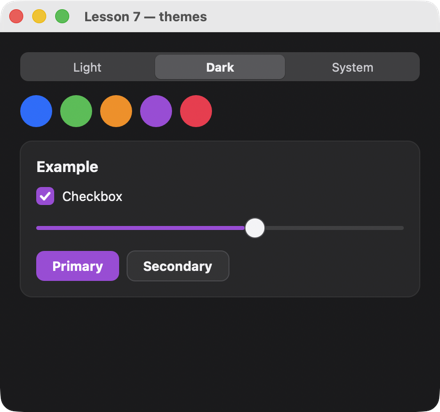

# Урок 7. Темы и токены

[English](../../../cpp/lessons/07-themes.md) · **Русский**

**Что будет:** вкладки «Light / Dark / System» и пять кружков-цветов: выбор перекрашивает флажок, ползунок и кнопку.



<!-- code: examples-cpp/lessons/07-themes/main.cpp -->
```cpp
// Lesson 7: themes and tokens. Element colors are theme tokens ($theme.primary, $theme.card…);
// cx.theme() changes the theme, cx.token() a single token.
#include <string>
#include <vector>

#include <uison_widgets.hpp>

using namespace uison::widgets;

struct State {
    std::string theme = "light", accent = "#007AFF";
    bool agree = true;
    int volume = 60;
    std::vector<std::string> accents{"#007AFF", "#34C759", "#FF9500", "#AF52DE", "#FF2D55"};
};

int main() {
    auto accent = [](uison::Cx& cx) {
        // key "accent-#34C759" → the color after the dash.
        auto color = std::string(cx.key().substr(cx.key().find('-') + 1));
        cx.token("primary", color);
        cx.data().set("accent", color);
    };
    auto screen = Column({.padding = 20, .gap = 14, .cross = "stretch", .children = {
        Tabs({.value = "@theme",
              .tabs = uison::choices({{"light", "Light"}, {"dark", "Dark"}, {"system", "System"}}),
              .key = "theme",
              .on_change = [](uison::Cx& cx) { cx.theme(cx.data().str("theme")); }}),
        Row({.gap = 8, .children = {For({.each = "@accents", .as = "c", .item = Box({
            .fill = "@c", .radius = 16, .w = 32, .h = 32, .key = "accent-{@c}", .on_click = accent})})}}),
        Card({.title = "Example", .children = {
            Checkbox("Checkbox", {.checked = "@agree"}),
            Slider({.value = "@volume", .min = 0, .max = 100}),
            Row({.gap = 8, .children = {Button("Primary"), Button("Secondary", {.variant = "secondary"})}}),
        }}),
    }});
    uison::Ui ui(screen, {.size = {440, 380}, .data = State{}, .theme = "light"});
    return ui.run("Lesson 7 — themes");
}
```

## Как это работает

1. **Токены.** Элементы библиотеки берут цвета из токенов темы: `$theme.primary`, `$theme.card`, `$theme.text`… Сменили тему — перекрасилось всё ([themes.md](../../screens/themes.md)).
2. **Тема целиком.** `cx.theme("dark")` в обработчике, `.theme = "light"` в `uison::Screen` (или `ui.theme("light")`) до запуска. `"system"` — как в системе, и экран сам переключится вместе с ОС.
3. **Один токен.** `cx.token("primary", "#AF52DE")` меняет главный цвет поверх темы — флажок, ползунок, кнопка перекрашиваются сразу.
4. **Цвет из данных.** `Box({.fill = "@c", …})` — привязка: цвет — элемент массива `accents`.
5. **Состояние структурой.** `State` с значениями по умолчанию — начальные данные экрана (`.data = State{}`).
6. **Вкладки.** `Tabs({.value = "@theme", .tabs = uison::choices({{"light", "Light"}, …})})` — выбор пишется в `theme`, `.on_change` вызывается после.

## Попробуйте

- Запоминать выбор между запусками: записать тему в файл в `.on_change` и прочитать при старте.
- `cx.token("radius", 2)` — все элементы почти квадратные.

Дальше — [урок 8: картинки, подсказки, меню](08-rich.md).
