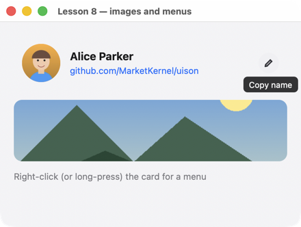
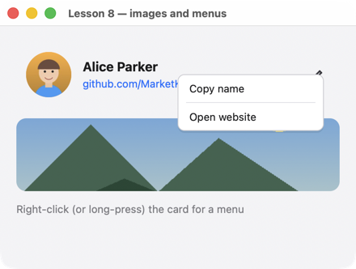

# Урок 8. Картинки, подсказки, меню

[English](../../../cpp/lessons/08-rich.md) · **Русский**

**Что будет:** карточка с фото, ссылкой и кнопкой с подсказкой; правой кнопкой (долгим нажатием на телефоне) — меню; ниже — картинка.





<!-- code: examples-cpp/lessons/08-rich/main.cpp -->
```cpp
// Lesson 8: images, tooltips, a context menu, links, the clipboard. Everything except images
// is just properties; an image is given as a file or as bytes (PNG or JPEG).
#include <uison_widgets.hpp>

using namespace uison::widgets;

static const char* SITE = "https://github.com/MarketKernel/uison";

int main() {
    auto copy = [](uison::Cx& cx) {
        cx.copy("Alice Parker");
        cx.data().set("status", "Name copied to clipboard");
    };
    auto card = Row({.padding = 12, .gap = 14, .cross = "center", .key = "card",
        // Context menu: label, action; "-" is a separator. Actions are called by name (ui.on below).
        .context_menu = uison::json(R"([{ label: "Copy name", action: "copy" }, "-", { label: "Open website", action: "site" }])"),
        .children = {
            Avatar("Alice Parker", {.size = 56, .src = "@photo"}),
            Column({.gap = 4, .flex = 1, .children = {
                Text("Alice Parker", {.size = 16, .bold = true}),
                Link("github.com/MarketKernel/uison", {.href = SITE}),
            }}),
            // Tooltip: on any node (appears after half a second of hovering).
            IconButton("edit", {.key = "copy", .tooltip = "Copy name", .on_click = "copy"}),
        }});
    auto screen = Column({.padding = 20, .gap = 14, .cross = "stretch", .children = {
        card,
        // Image: the size is given or natural (one side given, the other keeps the aspect ratio);
        // fit: cover (crop), contain (fit inside), fill (stretch).
        Image("@landscape", {.fit = "cover", .radius = 12, .h = 90}),
        Text("@status", {.color = "$theme.muted"}),
    }});
    uison::Ui ui(screen, {.size = {440, 300}, .data = uison::obj{{"status", "Right-click (or long-press) the card for a menu"}}});
    // An image from a file next to the program (CMake puts it there) → source "mem:photo".
    // Bytes from memory — ui.image("name", bytes).
    ui.data().set("photo", ui.image_file("photo", "photo.jpg"));
    ui.data().set("landscape", ui.image_file("landscape", "landscape.png"));
    ui.on("copy", copy);
    ui.on("site", [](uison::Cx& cx) { cx.open_url(SITE); });
    return ui.run("Lesson 8 — images and menus");
}
```

## Как это работает

1. **Картинки.** `ui.image_file("photo", "photo.jpg")` читает PNG или JPEG рядом с программой и возвращает источник `"mem:photo"`; его кладут в данные и привязывают: `Avatar(…, {.src = "@photo"})`, `Image("@landscape")`. Из памяти — `ui.image("name", bytes)`; файла нет — `uison::Error`.
2. **Размер картинки.** Задан один размер (`.h = 90`) — второй по пропорции; `.fit = "cover"` обрезает, `"contain"` вписывает, `"fill"` растягивает; `.radius` скругляет углы.
3. **Подсказка.** `.tooltip = "…"` у любого виджета: через полсекунды наведения, на телефоне — по долгому нажатию.
4. **Контекстное меню.** `.context_menu = uison::json(R"([{ label, action }, "-", …])")` — пункт вызывает действие по имени (`ui.on("copy", …)`), `cx.key()` — узел, где открыли меню.
5. **Обработчик по имени.** `.on_click = "copy"` — та же функция, что у пункта меню; лямбда — для одного места, имя — когда действие нужно в нескольких.
6. **Ссылка, буфер.** `Link("…", {.href = …})` открывает адрес; `cx.copy("…")` — в системный буфер обмена.

## Попробуйте

- Картинку, встроенную в программу: массив байтов (`xxd -i photo.jpg`) и `ui.image("photo", bytes)`.
- Аватар без фото: уберите `.src` — останутся инициалы на цветном кружке.

Дальше — [урок 9: потоки](09-threads.md).
