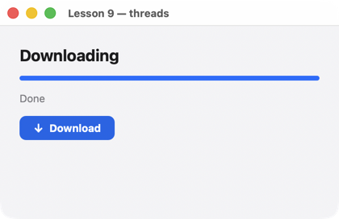

# Урок 9. Потоки

[English](../../../cpp/lessons/09-threads.md) · **Русский**

**Что будет:** «скачивание» в рабочем потоке: полоса прогресса, проценты, кнопка «Cancel». Интерфейс не замирает.



<!-- code: examples-cpp/lessons/09-threads/main.cpp -->
```cpp
// Lesson 9: work in another thread. The UI is touched only through Handle::post: the function runs
// on the UI thread (like a handler), and the screen updates itself. Cancellation is std::stop_token (C++20).
#include <chrono>
#include <string>
#include <thread>

#include <uison_widgets.hpp>

using namespace uison::widgets;

int main() {
    auto screen = Column({.padding = 24, .gap = 14, .cross = "stretch", .children = {
        Text("Downloading", {.size = 20, .bold = true}),
        ProgressBar({.value = "@progress"}),
        Text("@status", {.color = "$theme.muted"}),
        Row({.gap = 8, .children = {
            // Actions by name: the handlers need a handle, which only a constructed Ui has.
            Button("Download", {.icon = "arrowDown", .key = "start", .disabled = "@busy", .on_click = "start"}),
            Button("Cancel", {.variant = "secondary", .key = "cancel", .visible = "@busy", .on_click = "cancel"}),
        }}),
    }});
    uison::Ui ui(screen, {.size = {420, 240}, .data = uison::obj{{"progress", 0}, {"busy", false}, {"status", "Press “Download”"}}});
    uison::Handle handle = ui.handle(); // copied into threads
    std::jthread worker;                // lives in main: when the window closes, the thread is stopped and joined
    ui.on("start", [&](uison::Cx& cx) {
        cx.data().set("busy", true);
        worker = std::jthread([handle](std::stop_token stop) {
            for (int i = 1; i <= 40 && !stop.stop_requested(); i++) {
                std::this_thread::sleep_for(std::chrono::milliseconds(50)); // "download" a chunk
                handle.post([i](uison::Cx& cx) {
                    cx.data().set("progress", i / 40.0);
                    cx.data().set("status", "Downloaded " + std::to_string(i * 25 / 10) + "%");
                });
            }
            bool stopped = stop.stop_requested();
            handle.post([stopped](uison::Cx& cx) {
                cx.data().set("busy", false);
                cx.data().set("status", stopped ? "Cancelled" : "Done");
            });
        });
    });
    ui.on("cancel", [&] { worker.request_stop(); });
    return ui.run("Lesson 9 — threads");
}
```

## Как это работает

1. **Интерфейс — в одном потоке.** Данные, дерево, обработчики живут в потоке окна. Долгая работа — в другом потоке, иначе окно не отвечает.
2. **`Handle::post`.** `ui.handle()` — ссылка на интерфейс для других потоков (копируется, брать до `run`). `handle.post([](uison::Cx& cx) { … })` ставит лямбду в очередь: она выполнится в потоке окна как обычный обработчик, и экран обновится.
3. **`std::jthread` и отмена.** Поток получает `std::stop_token`; кнопка «Cancel» — `worker.request_stop()`. `jthread` живёт в `main`: окно закрыли — деструктор просит поток остановиться и ждёт его. В libc++ до LLVM 20 (Xcode 16 и раньше) `jthread` есть только с `-fexperimental-library`; `CMakeLists.txt` уроков проверяет это и добавляет флаг сам.
4. **Лямбды со ссылками на `main`.** `[&]` захватывает `worker` и `handle` из `main` — они живут, пока работает окно (и в браузере тоже: `main` там не разматывается).
5. **Действия по имени.** Обработчикам нужен `handle`, а он есть только у готового `Ui`, поэтому кнопки называют действия (`.on_click = "start"`).
6. **Браузер.** В WebAssembly потоков нет: урок там не собирается, `post` работает из того же потока.

## Попробуйте

- Настоящая загрузка: HTTP-клиент в потоке, прогресс по байтам.
- Несколько загрузок сразу: вектор структур в данных и `For` с `ProgressBar` в шаблоне.

Дальше — [урок 10: свой кадр](10-frame.md).
