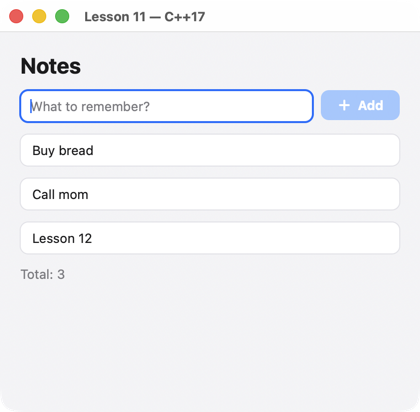

# Урок 11. C++17 и JSON

[English](../../../cpp/lessons/11-cpp17.md) · **Русский**

**Что будет:** заметки — экран без виджетов C++20: цепочкой методов `uison::Node`, свой элемент — JSON-строкой.



<!-- code: examples-cpp/lessons/11-cpp17/main.cpp -->
```cpp
// Lesson 11 (C++17): a screen without C++20 widgets, as a uison::Node method chain; a custom component as a JSON string.
#include <string>

#include <uison.hpp>

// A custom component in the same JSON as in a components.json file (R"json(…)json": JSON may contain `)"`).
static const char* COMPONENTS = R"json({
  Note: {
    params: { text: "" },
    body: { Box: { padding: [8, 12], radius: 8, fill: "$theme.card", stroke: "$theme.divider", width: 1,
                   child: { Text: { text: "$text" } } } },
  },
})json";

int main() {
    // One lambda both for the button and for Enter in the field.
    auto add = [](uison::Cx& cx) {
        auto d = cx.data();
        if (d.str("draft").empty()) return;
        d.push("notes", d.get<std::string>("draft"));
        d.set("draft", "");
    };
    auto screen = uison::column().padding(20).gap(12).cross("stretch").children({
        uison::text("Notes").size(22).bold(),
        uison::row().gap(8).children({
            uison::text_field().bind("draft").placeholder("What to remember?").flex().key("draft").on_submit(add),
            uison::button("Add").icon("plus").key("add").disabled("!@draft").on_click(add),
        }),
        uison::for_each("notes", "n", uison::node("Note").prop("text", "@n")),
        uison::text("Total: {@count}").color("$theme.muted"),
    });
    // The rest of the screen settings as {key, value} pairs (in C++20, the uison::Screen struct).
    uison::Ui ui(screen, {{"size", uison::arr{420, 380}}, {"data", uison::obj{{"draft", ""}, {"notes", uison::arr{"Buy bread"}}}}});
    ui.components(COMPONENTS);
    ui.derive([](uison::Data& d) { d.set("count", d.len("notes")); });
    return ui.run("Lesson 11 — C++17");
}
```

## Как это работает

1. **Цепочка методов.** `uison::column().gap(12).children({…})` — то же дерево, что виджеты, но без назначенных инициализаторов: работает в C++17. Методы — у одного класса `Node` (`.prop("anything", value)` — для свойств, у которых метода нет), лямбды — `.on_click(…)`.
2. **Экран JSON-строкой** — `uison::Ui ui(R"json({ … })json")`: короче всего, но ошибки видны только при запуске (с местом). Метка `json` в `R"json(` нужна: в JSON встречается `)"`.
3. **Экран файлом** — `uison::Ui::load("screen.json")`: правится без пересборки, с `UISON_RELOAD=folder` — прямо в работающей программе.
4. **Остальное о экране** в C++17 — парами `{{"size", uison::arr{420, 380}}, {"data", uison::obj{…}}}` (в C++20 — структурой `uison::Screen`).

## Когда что

| | виджеты (C++20) | цепочка (C++17) | JSON-строка | файл |
|---|---|---|---|---|
| имена свойств проверяет | компилятор | при запуске | при запуске | при запуске |
| подсказки IDE | все поля с описаниями | частые методы | нет | редактор JSON |
| лямбды у элементов | да | да | нет (по имени) | нет (по имени) |
| правка без пересборки | нет | нет | нет | да, `UISON_RELOAD` |
| общий с C и Rust | нет | нет | да | да |

Их можно смешивать: экран — виджетами, свой элемент — JSON (как здесь), большой справочный экран — файлом.

## Попробуйте

- Перепишите урок виджетами и сравните длину и сообщения компилятора при ошибке в имени свойства.
- Вынесите экран в файл `screen.json` и загрузите его `uison::Ui::load`.

Дальше — [урок 12: сборка, телефоны, браузер](12-build.md).
