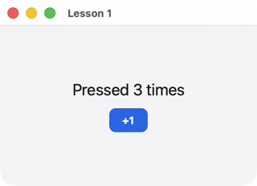

# Урок 0. Подготовка системы

[English](../../../rust/lessons/00-setup.md) · **Русский**

**Что будет:** Rust и всё, что ему нужно, чтобы собрать окно; в конце — урок 1 на вашей машине.

Нужно три вещи: **Rust** (ставится `rustup`), **линкер системы** (Rust собирает программу, а склеивает её линкер ОС) и **git**. Библиотеки для окон, графики и шрифтов ставить не нужно: uison берёт их у системы — на macOS и Windows они есть всегда, на Linux есть в любом рабочем столе.

## macOS

1. Инструменты командной строки Apple (линкер, git):

   ```sh
   xcode-select --install
   ```

   Если стоит Xcode из App Store — они уже есть. Xcode целиком понадобится только для iPhone ([урок 11](11-everywhere.md)).
2. Rust:

   ```sh
   curl --proto '=https' --tlsv1.2 -sSf https://sh.rustup.rs | sh
   ```

   Установщик спросит про настройки — Enter (по умолчанию). Потом откройте новое окно терминала (или `source "$HOME/.cargo/env"`).

## Linux

1. Компилятор C (Rust берёт у него линкер), curl, git:

   | дистрибутив | команда |
   |---|---|
   | Ubuntu, Debian, Mint | `sudo apt install build-essential curl git` |
   | Fedora | `sudo dnf install gcc curl git` |
   | Arch, Manjaro | `sudo pacman -S --needed base-devel curl git` |
   | openSUSE | `sudo zypper install gcc curl git` |

2. Rust — так же, как на macOS:

   ```sh
   curl --proto '=https' --tlsv1.2 -sSf https://sh.rustup.rs | sh
   ```

Пакеты `-dev` (Wayland, X11, Cairo, Pango) не нужны: uison загружает эти библиотеки во время работы, и программа зависит только от libc. Нужен рабочий стол — GNOME, KDE, Sway, Xfce… — с Wayland или X11. На сервере без экрана окну открыться негде.

## Windows

> Раздел написан по документации и ещё не пройден вживую на чистой Windows (запланировано: проверка и снимки экрана установщика).

1. Скачайте **rustup-init.exe** с [rustup.rs](https://rustup.rs) и запустите. Rust на Windows собирает программы инструментами Microsoft (MSVC), и установщик предложит их поставить:

   ```text
   1) Quick install via the Visual Studio Community installer
   ```

   Выберите **1**. Откроется установщик Visual Studio с уже отмеченными «Средствами сборки C++ MSVC» и «Windows SDK» — нажмите «Установить» (около 2–3 ГБ). Если Visual Studio с нагрузкой «Разработка классических приложений на C++» уже стоит — этот шаг пропускается сам.
2. Вернитесь в окно rustup и нажмите Enter (установка по умолчанию).
3. **Git**: [git-scm.com](https://git-scm.com/download/win) или `winget install Git.Git`.
4. Откройте **новое** окно PowerShell или терминала — чтобы подхватились пути.

## Редактор

Подойдёт любой. Удобнее всего с подсказками Rust:
- **VS Code** + расширение **rust-analyzer** — автодополнение элементов и свойств DSL, переход к определению, ошибки сразу в коде;
- **RustRover** (JetBrains) — то же из коробки;
- **Zed**, **Helix** — rust-analyzer встроен.

## Проверка

```sh
rustc --version
cargo --version
git --version
```

Все три печатают версию (Rust — 1.88 или новее). Теперь урок 1 — прямо из репозитория uison:

```sh
git clone https://github.com/MarketKernel/uison
cd uison
cargo run --release -p uison --example 01-hello
```

Первая сборка — минута-две, дальше — секунды. Откроется окно с кнопкой «+1».



Что-то не так:
- `linker 'cc' not found` (Linux) — не поставлен компилятор C, шаг 1;
- `link.exe not found` (Windows) — не поставлены средства сборки MSVC: запустите «Visual Studio Installer» → «Изменить» → «Разработка классических приложений на C++»;
- окно не открылось на Linux, в терминале ошибка `Wayland: …` — программа запущена без рабочего стола (по SSH, в контейнере).

Дальше — [урок 1: окно и кнопка](01-hello.md), или сразу [свой крейт](../quickstart.md).
