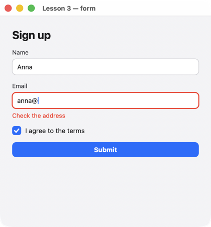

# Урок 3. Форма с проверкой

[English](../../../rust/lessons/03-forms.md) · **Русский**

**Что будет:** регистрация — имя, email, согласие. Ошибки появляются после первой попытки отправить и исчезают по мере исправления; фокус встаёт на первое поле с ошибкой.



<!-- code: crates/uison/examples/03-forms.rs -->
```rust
//! Lesson 3: a form with validation. The form is a struct (`#[derive(Data)]`); derive recomputes the errors
//! after every data change, the submit handler puts focus on the first field with an error.
use uison::prelude::*;

#[derive(Data, Default)]
struct Form {
    name: String,
    email: String,
    agree: bool,
}

#[derive(Data, Default)]
struct Errors {
    name: String,
    email: String,
}

fn main() {
    let screen = column().padding(24).gap(14).cross("stretch").children([
        text("Sign up").size(22).bold(),
        text_field().key("name").label("Name").bind("form.name").error("@errors.name"),
        text_field().key("email").label("Email").bind("form.email").error("@errors.email").keyboard("email").on_submit(submit),
        checkbox("I agree to the terms").key("agree").bind("form.agree"),
        button("Submit").key("submit").disabled("!@form.agree").on_click(submit),
        text("@sent").color("$theme.success").visible("@sent"),
    ]);
    let mut ui = Ui::from_node(screen).with_size(420.0, 420.0);
    ui.data.set("form", Form::default());
    ui.data.set("errors", Errors::default());
    ui.data.set("tried", false);
    ui.data.set("sent", "");
    ui.derive(validate);
    run(ui, "Lesson 3 — form");
}

fn valid_email(e: &str) -> bool {
    match e.find('@') {
        Some(at) => at > 0 && e[at..].contains('.') && !e.ends_with('.'),
        None => false,
    }
}

/// Errors are shown after the first attempt to submit, then as the user types.
fn validate(d: &mut Data) {
    if !d.bool("tried") {
        return;
    }
    let f: Form = d.read("form").unwrap_or_default();
    let name = if f.name.is_empty() { "Enter your name" } else { "" };
    let email = if valid_email(&f.email) { "" } else { "Check the address" };
    d.set("errors", Errors { name: name.into(), email: email.into() });
}

fn submit(cx: &mut Cx) {
    cx.data.set("tried", true);
    validate(cx.data);
    let e: Errors = cx.data.read("errors").unwrap_or_default();
    if !e.name.is_empty() {
        cx.focus("name/1/0"); // the input inside the TextField "name"
    } else if !e.email.is_empty() {
        cx.focus("email/1/0");
    } else {
        let f: Form = cx.data.read("form").unwrap_or_default();
        cx.data.set("sent", format!("Done, {}! We'll write to {}", f.name, f.email));
    }
}
```

## Как это работает

1. **Форма — структура.** `#[derive(Data)]` учит структуру переходить в данные и обратно: `ui.data.set("form", Form::default())` кладёт объект `{ name, email, agree }`, а `d.read::<Form>("form")` читает его в структуру. Поля, которых нет в данных, берутся из `Default`. Имя в данных — как у поля; другое — `#[data(rename = "isDone")]`, не в данных — `#[data(skip)]`.
2. **Привязки к полям структуры.** `bind("form.name")` — путь внутрь объекта. Структура в коде и данные экрана — одно и то же, только в разных видах.
3. **Ошибки.** У `text_field` есть свойство `error`: непустая строка — красная рамка и текст под полем. Ошибки — тоже данные (`errors`), их пересчитывает `validate`.
4. **Когда показывать.** `validate` ничего не делает, пока `tried` ложно: до первой попытки форма «чистая». После — `derive` вызывает её на каждое изменение, и ошибки исчезают, как только поле исправлено.
5. **Фокус.** `cx.focus("name/1/0")` ставит каретку в поле. `TextField` — элемент библиотеки из нескольких узлов, а само поле ввода — его часть `name/1/0` (key элемента и путь внутри). Нажатие Enter в поле email (`on_submit`) — то же, что кнопка.
6. **`derive` и обработчик.** `validate` — обычная функция над `&mut Data`: её зовут и `derive`, и `submit` (чтобы решить, куда ставить фокус).

## Попробуйте

- Проверку длины имени (не меньше двух букв).
- Пароль: `text_field().password()` и проверка совпадения двух полей.

Дальше — [урок 4: списки](04-lists.md).
