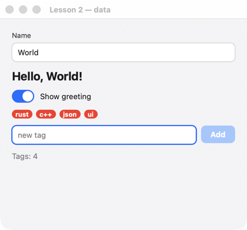

# Lesson 2. Data and bindings

**English** · [Русский](../../ru/rust/lessons/02-data.md)

**What you'll get:** a "Name" field and a greeting that changes as you type; a switch that hides it; tag badges and a field that adds new ones.



<!-- code: crates/uison/examples/02-data.rs -->
```rust
//! Lesson 2: data and bindings. Elements read data by paths (`@name`), an input field writes it;
//! code changes the data, and the screen follows it by itself.
use uison::prelude::*;

fn main() {
    let screen = column().padding(20).gap(12).cross("stretch").children([
        // Two-way binding: the field writes to name, the text below reads it.
        text_field().key("name").label("Name").bind("name"),
        text("Hello, {@name}!").size(20).bold().visible("@show"),
        switch("Show greeting").key("show").bind("show"),
        // A list: for_each repeats the template for each element of the tags array.
        wrap().gap(6).children([for_each("tags", "t", badge("@t"))]),
        row().gap(8).children([
            text_field().key("draft").bind("draft").placeholder("new tag").flex(1).on_submit(add),
            button("Add").key("add").disabled("!@draft").on_click(add),
        ]),
        // A conditional value: a switch on data, in the screen language, as a string.
        text("Tags: {@count}").color(json(r#"{ switch: "@many", cases: { true: "$theme.danger" }, default: "$theme.muted" }"#)),
    ]);
    let mut ui = Ui::from_node(screen).with_size(420.0, 360.0);
    ui.data.set("name", "World");
    ui.data.set("show", true);
    ui.data.set("tags", vec!["rust", "c++"]);
    ui.data.set("draft", "");
    // Derived data: recomputed after any change.
    ui.derive(|d| {
        let n = d.len("tags");
        d.set("count", n);
        d.set("many", n >= 5);
    });
    run(ui, "Lesson 2 — data");
}

/// One function for two events: Enter in the field and the button.
fn add(cx: &mut Cx) {
    let tag = cx.data.str("draft").to_string();
    cx.data.push("tags", tag);
    cx.data.set("draft", "");
}
```

## How it works

1. **Two-way binding.** `text_field().bind("name")` — the field shows `name` and writes to it as you type. `text("Hello, {@name}!")` reads the same value — the greeting changes with every letter, without handlers. On `checkbox` and `switch`, `bind` binds `checked`; on everything else, `value`.
2. **Visibility.** `.visible("@show")` — the node exists while `show` is truthy. `"!@show"` is the opposite. Truthiness works as in JavaScript: falsy values are `false`, `0`, `""`, `[]`, `null`.
3. **Lists.** `for_each("tags", "t", badge("@t"))` repeats the template for each element of the `tags` array; inside it, `@t` is the current element. Add an element to the array, and a badge appears.
4. **One function for two events.** `add` is a plain function `fn(&mut Cx)`: you can pass it both to `on_submit` (Enter in the field) and to `on_click`. `cx.data.push("tags", …)` appends to the end of the array.
5. **Derived data.** `ui.derive(|d| …)` is called after every data change: here it counts the tags. The screen is bound to the result (`{@count}`), so the counter is always correct — wherever the tags change.
6. **Choosing a value.** `json(r#"{ switch: "@many", cases: { true: "$theme.danger" }, default: "$theme.muted" }"#)` is a value in the screen language: a color chosen by data. Such selectors and functions (`eq`, `not`, `len`…) are in the [bindings reference](../../screens/bindings.md).

## Try it

- Don't add a tag that already exists.
- Remove a tag by tapping its badge: `.key("tag-{@t}")` and `.on_click(…)` on `badge`; which one — from `cx.key`.

Next — [lesson 3: a form with validation](03-forms.md).
