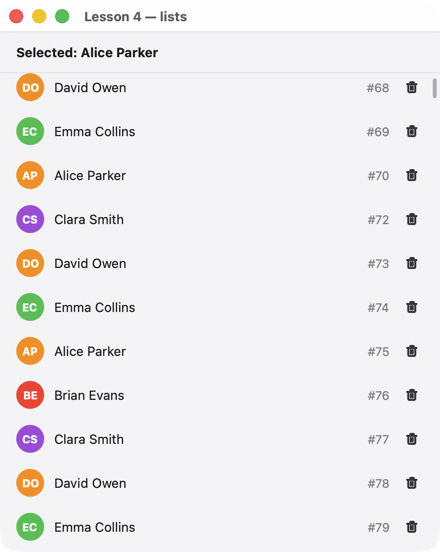

# Lesson 4. Lists

**English** · [Русский](../../ru/rust/lessons/04-lists.md)

**What you'll get:** a list of 10,000 rows with avatars. Tapping a row shows the name at the top; the trash button deletes the row.



<!-- code: crates/uison/examples/04-lists.rs -->
```rust
//! Lesson 4: lists. `list` draws only the visible rows, so 10,000 elements don't slow it down.
//! Which row was pressed comes from the node's key (`cx.key`: "row-17", "del-17").
use uison::prelude::*;

#[derive(Data, Default)]
struct Person {
    id: i32,
    name: String,
}

fn main() {
    // The row template: @r is the current element of rows; one closure for all rows.
    let item = row().key("row-{@r.id}").padding([0, 16]).gap(10).cross("center").on_click(pick).children([
        avatar("@r.name").size(28),
        text("@r.name").flex(1),
        text("#{@r.id}").size(12).color("$theme.muted"),
        icon_button("trash").key("del-{@r.id}").size("sm").on_click(remove),
    ]);
    let screen = column().w("fill").h("fill").cross("stretch").children([
        container().padding([12, 16]).child(text("@picked").bold()),
        divider(),
        list("rows", "r", 44.0, item).key("list").flex(1),
    ]);
    let mut ui = Ui::from_node(screen).with_size(440.0, 520.0);
    let names = ["Alice Parker", "Brian Evans", "Clara Smith", "David Owen", "Emma Collins"];
    let rows: Vec<Person> = (0..10_000).map(|i| Person { id: i, name: names[i as usize % 5].into() }).collect();
    ui.data.set("rows", rows);
    ui.data.set("picked", "Pick a row");
    run(ui, "Lesson 4 — lists");
}

/// Index of the row with this id in rows (after deletions index and id differ).
fn find(d: &Data, id: f64) -> Option<usize> {
    d.get("rows")?.as_array()?.iter().position(|r| r.get("id").and_then(Json::as_f64) == Some(id))
}

/// The number at the end of the key: "row-17" → 17.
fn key_num(key: &str) -> f64 {
    key.rsplit('-').next().and_then(|n| n.parse().ok()).unwrap_or(-1.0)
}

fn pick(cx: &mut Cx) {
    if let Some(i) = find(cx.data, key_num(cx.key)) {
        let name = cx.data.str(&format!("rows.{i}.name")).to_string();
        cx.data.set("picked", format!("Selected: {name}"));
    }
}

fn remove(cx: &mut Cx) {
    if let Some(i) = find(cx.data, key_num(cx.key)) {
        cx.data.remove("rows", i);
    }
}
```

## How it works

1. **Virtualization.** `list("rows", "r", 44.0, item)` is a scroll view that expands only the visible rows: 10,000 rows are no slower than twenty. All rows have the same height (`44.0`). `for_each` would expand them all — it is meant for dozens of rows.
2. **List data.** A `Vec<Person>` with `#[derive(Data)]` goes into the data with a single `set`. Inside the template, `@r` is the current element and `@r.name` is its field.
3. **Which row was tapped.** There is one closure for all rows, and rows differ by `key`: `"row-{@r.id}"` expands to `row-17`. In the handler, `cx.key` is `row-17`; the number at the end is the row id.
4. **Index and id.** After a deletion the row indices shift, but the ids stay. That's why `find` looks the row up by id (`rows.3.id == 17`) instead of taking the index from the key.
5. **Nested events.** Tapping the trash button calls `remove`, not `pick`: an event bubbles up from the tapped node to the first one that has a handler, and goes no further.
6. **Data as JSON.** `cx.data.get("rows")` is a `&Json`: for 10,000 rows it's faster to walk the tree than to read the whole array into a `Vec<Person>`.

## Try it

- A search field above the list: `derive` builds `visible` from `rows` by substring, and `list` shows `visible`.
- Highlight the selected row: `.fill(json(r#"{ switch: … }"#))` by `@picked_id`.

Next — [lesson 5: a screen from JSON](05-json.md).
