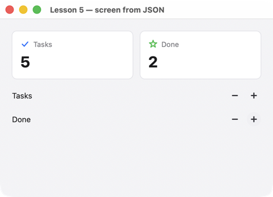

# Lesson 5. A screen from JSON

**English** · [Русский](../../ru/rust/lessons/05-json.md)

**What you'll get:** the screen and custom elements are JSON files next to the program: two counter cards and rows with "−" and "+" buttons. You can edit the files while the program is running.



<!-- code: crates/uison/examples/05-json.rs -->
```rust
//! Lesson 5: the screen and custom components are JSON files next to the program. `source!` embeds the file
//! into the program and remembers its name: with `UISON_RELOAD=folder` (debug build) the screen is read
//! from disk and rebuilt when the file is saved, without a restart.
use uison::prelude::*;

fn main() {
    let mut ui = match Ui::load(source!("05-json/screen.json")) {
        Ok(ui) => ui,
        Err(e) => return eprintln!("{e}"),
    };
    if let Err(e) = ui.load_components(source!("05-json/components.json")) {
        return eprintln!("{e}");
    }
    // One handler for several buttons: which one was pressed comes from the key ("inc-Tasks", "dec-Done").
    ui.on("inc", |cx| change(cx, 1.0));
    ui.on("dec", |cx| change(cx, -1.0));
    run(ui, "Lesson 5 — screen from JSON");
}

fn change(cx: &mut Cx, step: f64) {
    let path = if cx.key.contains("Tasks") { "tasks" } else { "done" };
    let v = (cx.data.num(path) + step).max(0.0);
    cx.data.set(path, v);
}
```

The screen — `05-json/screen.json`:

<!-- code: crates/uison/examples/05-json/screen.json -->
```js
// The lesson 5 screen: custom components Stat and Counter from components.json.
{
  size: [460, 300],
  data: { tasks: 3, done: 1 },
  root: { Column: { padding: 20, gap: 16, cross: "stretch", children: [
    { Row: { gap: 12, children: [
      { Stat: { title: "Tasks", value: "@tasks", icon: "check" } },
      { Stat: { title: "Done", value: "@done", icon: "star", color: "$theme.success" } },
    ] } },
    { Counter: { label: "Tasks" } },
    { Counter: { label: "Done" } },
  ] } }
}
```

Custom components — `05-json/components.json`:

<!-- code: crates/uison/examples/05-json/components.json -->
```js
// Custom components: params are the parameters with default values, body is the tree,
// inside it parameters are $name. The screen uses them like built-in ones: { Stat: { title: … } }.
{
  Stat: {
    params: { title: "", value: 0, icon: "star", color: "$theme.primary" },
    body: {
      Box: {
        flex: 1, padding: 14, radius: "$theme.radius", fill: "$theme.card", stroke: "$theme.divider",
        child: { Column: { gap: 6, children: [
          { Row: { gap: 6, cross: "center", children: [
            { Icon: { name: "$icon", size: 16, color: "$color" } },
            { Text: { text: "$title", size: 12, color: "$theme.muted" } },
          ] } },
          { Text: { text: "$value", size: 26, bold: true } },
        ] } },
      },
    },
  },

  // The button keys are built from a parameter ("inc-{$label}"): each Counter has its own buttons,
  // while the handler is one; it tells which was pressed by the key.
  Counter: {
    params: { label: "" },
    body: {
      Row: { gap: 8, cross: "center", children: [
        { Text: { text: "$label", flex: 1 } },
        { IconButton: { icon: "minus", size: "sm", key: "dec-{$label}", on: { click: "dec" } } },
        { IconButton: { icon: "plus", size: "sm", key: "inc-{$label}", on: { click: "inc" } } },
      ] },
    },
  },
}
```

## How it works

1. **`source!`** embeds a file into the program (like `include_str!`) and remembers its name. The program is still a single file; it doesn't need the JSON next to it.
2. **Live reload.** A debug build with `UISON_RELOAD=folder` reads files with the same names from that folder and rebuilds the screen when you save — without a restart, and the data is kept:

   ```sh
   UISON_RELOAD=crates/uison/examples/05-json cargo run -p uison --example 05-json
   ```

   Change a label or a color in `screen.json` and save — the window updates. Release builds have no reload.
3. **Custom components.** `Stat` and `Counter` are templates: `params` (parameters and their default values) and `body` (the tree; inside it parameters are `$name`). On the screen they are used like built-in ones: `{ Stat: { title: "Tasks", value: "@tasks" } }`. Details — in the [reference](../../screens/bindings.md#component-parameters-param).
4. **Handlers by name.** JSON has no closures: buttons name an action (`on: { click: "inc" }`), and the program registers it — `ui.on("inc", |cx| …)`.
5. **One handler for many buttons.** The button's key is built from a parameter: `"inc-{$label}"` → `inc-Tasks`, `inc-Done`. The handler identifies the button by `cx.key`.

## DSL or JSON

| | DSL | JSON |
|---|---|---|
| handlers | closures right on the elements | by name, `ui.on` |
| checking | method names — by the compiler | property names — at load time, with the error location |
| editing | rebuild | live reload |
| who edits | the programmer | a designer too, and a program in another language (C and C++ open the same file) |

You can mix them: a screen in JSON and a custom component in the DSL, and vice versa.

## Try it

- Add a `Progress` component (a bar by `value` and `max`) to `components.json` and show it under the counters — without rebuilding the program.
- Generate a DSL for your components: `cargo run -p uison-gen -- --rust components.json` — functions `stat()`, `counter()` and methods for their properties.

Next — [lesson 6: themes and tokens](06-themes.md).
