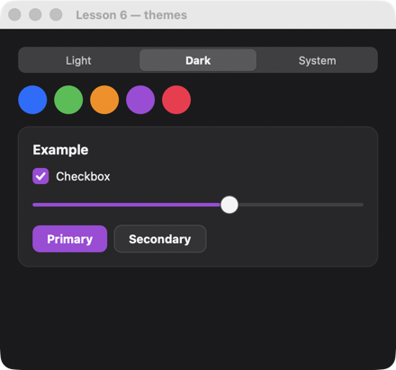

# Lesson 6. Themes and tokens

**English** · [Русский](../../ru/rust/lessons/06-themes.md)

**What you'll get:** "Light / Dark / System" tabs and five color circles: picking one recolors the checkbox, the slider and the button.



<!-- code: crates/uison/examples/06-themes.rs -->
```rust
//! Lesson 6: themes and tokens. Element colors are theme tokens (`$theme.primary`, `$theme.card`…);
//! `cx.set_theme` changes the theme, `cx.set_token` a single token.
use uison::prelude::*;

fn main() {
    let accents = row().gap(8).children([for_each(
        "accents",
        "c",
        container().key("accent-{@c}").w(32).h(32).radius(16).fill("@c").on_click(|cx| {
            // key "accent-#34C759" → the color after the dash.
            let color = cx.key.rsplit('-').next().unwrap_or("").to_string();
            cx.set_token("primary", color.as_str());
            cx.data.set("accent", color);
        }),
    )]);
    let screen = column().padding(20).gap(14).cross("stretch").children([
        tabs()
            .key("theme")
            .bind("theme")
            .on_change(|cx| {
                let t = cx.data.str("theme").to_string();
                cx.set_theme(&t);
            })
            .tabs(&[("light", "Light"), ("dark", "Dark"), ("system", "System")]),
        accents,
        card([
            checkbox("Checkbox").bind("agree"),
            slider().bind("volume").min(0).max(100),
            row().gap(8).children([button("Primary"), button("Secondary").variant("secondary")]),
        ])
        .title("Example"),
    ]);
    let mut ui = Ui::from_node(screen).with_size(440.0, 380.0);
    ui.set_theme("light");
    ui.data.set("theme", "light");
    ui.data.set("accent", "#007AFF");
    ui.data.set("agree", true);
    ui.data.set("volume", 60);
    ui.data.set("accents", vec!["#007AFF", "#34C759", "#FF9500", "#AF52DE", "#FF2D55"]);
    run(ui, "Lesson 6 — themes");
}
```

## How it works

1. **Tokens.** Library elements don't take colors directly but from theme tokens: `$theme.primary`, `$theme.card`, `$theme.text`… Change the theme, and everything is recolored. The list of tokens — [themes.md](../../screens/themes.md).
2. **A whole theme.** `cx.set_theme("dark")` in a handler, `ui.set_theme("light")` before running. `"system"` follows the system, and the screen switches by itself when the user changes the OS theme.
3. **A single token.** `cx.set_token("primary", "#AF52DE")` changes the primary color on top of the theme — the checkbox, the slider and the "Primary" button are recolored at once.
4. **A color from data.** `.fill("@c")` on a circle is a binding: the color comes from an element of the `accents` array.
5. **Tabs.** `tabs().bind("theme").tabs(&[…])` — the choice is written to `theme`, and `on_change` is called afterwards.

## Try it

- Remember the choice between runs: write the theme to a file in `on_change` and read it at startup.
- A token of your own: you don't need `ui.data` — `cx.set_token("radius", 2)` makes all elements almost square.

Next — [lesson 7: images, tooltips, menus](07-rich.md).
