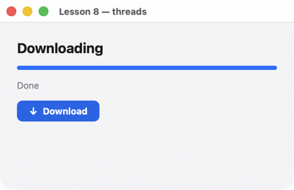

# Lesson 8. Threads

**English** · [Русский](../../ru/rust/lessons/08-threads.md)

**What you'll get:** a "download" in a worker thread: a progress bar, a percentage, a "Cancel" button. The interface doesn't freeze.



<!-- code: crates/uison/examples/08-threads.rs -->
```rust
//! Lesson 8: work in another thread. The UI is touched only through `Handle::post`: the function
//! runs on the UI thread (like a handler), and the screen updates itself. Cancellation is an atomic flag.
use std::sync::Arc;
use std::sync::atomic::{AtomicBool, Ordering};
use std::time::Duration;

use uison::prelude::*;

fn main() {
    let screen = column().padding(24).gap(14).cross("stretch").children([
        text("Downloading").size(20).bold(),
        progress("@progress"),
        text("@status").color("$theme.muted"),
        row().gap(8).children([
            // Actions by name: the handlers need a handle, which only a constructed Ui has.
            button("Download").key("start").icon("arrowDown").disabled("@busy").on("click", "start"),
            button("Cancel").key("cancel").variant("secondary").visible("@busy").on("click", "cancel"),
        ]),
    ]);
    let mut ui = Ui::from_node(screen).with_size(420.0, 240.0);
    ui.data.set("progress", 0);
    ui.data.set("busy", false);
    ui.data.set("status", "Press “Download”");
    let handle = ui.handle(); // cloned into threads
    let cancel = Arc::new(AtomicBool::new(false));
    let stop = cancel.clone();
    ui.on("start", move |cx| {
        cx.data.set("busy", true);
        stop.store(false, Ordering::Relaxed);
        let (h, stop) = (handle.clone(), stop.clone());
        std::thread::spawn(move || {
            for i in 1..=40 {
                if stop.load(Ordering::Relaxed) {
                    break;
                }
                std::thread::sleep(Duration::from_millis(50)); // "download" a chunk
                h.post(move |cx| {
                    cx.data.set("progress", i as f64 / 40.0);
                    cx.data.set("status", format!("Downloaded {}%", i * 25 / 10));
                });
            }
            let stopped = stop.load(Ordering::Relaxed);
            h.post(move |cx| {
                cx.data.set("busy", false);
                cx.data.set("status", if stopped { "Cancelled" } else { "Done" });
            });
        });
    });
    ui.on("cancel", move |_| cancel.store(true, Ordering::Relaxed));
    run(ui, "Lesson 8 — threads");
}
```

## How it works

1. **The interface lives in one thread.** Data, the tree and handlers live in the window's thread. Long work (network, files, computation) goes to another thread, or the window stops responding.
2. **`Handle::post`.** `ui.handle()` is a reference to the interface that you can pass to threads (`Send + Sync`, cloneable). `h.post(|cx| …)` queues a closure: it runs in the window's thread like an ordinary handler, with `cx.data`, and the screen updates.
3. **Cancellation.** An `AtomicBool` flag is shared by the "Cancel" button and the thread; the thread checks it at every step.
4. **Actions by name.** The closure needs `handle`, which exists only once `Ui` is created, so the buttons here name actions (`.on("click", "start")`), and the handlers are registered after `Ui::from_node`.
5. **The browser.** WebAssembly has no threads; `post` works from the same thread (from timers, network responses).

## Try it

- A real download: `std::net::TcpStream` or an HTTP client in the thread, with progress by bytes read.
- Several downloads at once: a list in the data, each with its own progress (`progress("@d.progress")` in `for_each`).

Next — [lesson 9: testing screens](09-tests.md).
