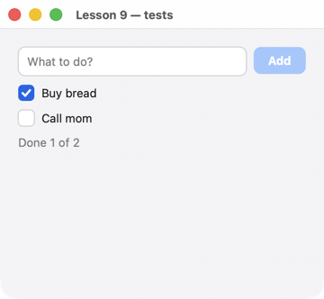

# Lesson 9. Testing screens

**English** · [Русский](../../ru/rust/lessons/09-tests.md)

**What you'll get:** a to-do list tested by `cargo test` without a window: the test presses buttons by key, types text, and reads the data and the texts on the screen.



<!-- code: crates/uison/examples/09-tests.rs -->
```rust
//! Lesson 9: screen tests. The function `app()` builds the screen; the program opens it, and the tests below
//! tap elements by key and check data and texts, headless:
//! `cargo test -p uison --example 09-tests`.
use uison::prelude::*;

#[derive(Data, Default)]
struct Todo {
    id: i32,
    title: String,
    done: bool,
}

fn app() -> Ui {
    let screen = column().padding(20).gap(10).cross("stretch").children([
        row().gap(8).children([
            text_field().key("draft").bind("draft").placeholder("What to do?").flex(1).on_submit(add),
            button("Add").key("add").disabled("!@draft").on_click(add),
        ]),
        for_each("todos", "t", checkbox("@t.title").key("todo-{@t.id}").bind("t.done")),
        text("Done {@done} of {@total}").color("$theme.muted"),
    ]);
    let mut ui = Ui::from_node(screen).with_size(360.0, 300.0);
    ui.data.set("draft", "");
    ui.data.set("todos", Vec::<Todo>::new());
    ui.data.set("next", 1);
    ui.derive(|d| {
        let todos: Vec<Todo> = d.read("todos").unwrap_or_default();
        d.set("total", todos.len());
        d.set("done", todos.iter().filter(|t| t.done).count());
    });
    ui
}

fn add(cx: &mut Cx) {
    let title = cx.data.str("draft").trim().to_string();
    if title.is_empty() {
        return;
    }
    let id = cx.data.num("next") as i32;
    cx.data.push("todos", Todo { id, title, done: false });
    cx.data.set("next", id + 1);
    cx.data.set("draft", "");
}

fn main() {
    run(app(), "Lesson 9 — tests");
}

#[cfg(test)]
mod tests {
    use uison::KeyCode;

    use super::*;

    /// The input inside the TextField "draft" is the node "draft/1/0" (library elements have their own parts).
    fn add_todo(ui: &mut Ui, title: &str) {
        assert!(ui.tap("draft/1/0"));
        ui.type_text(title);
        ui.press_key(KeyCode::Enter);
    }

    #[test]
    fn adds_todo_by_enter_and_button() {
        let mut ui = app();
        add_todo(&mut ui, "Buy bread");
        assert!(ui.tap("draft/1/0"));
        ui.type_text("Call mom");
        assert!(ui.tap("add"));
        let todos: Vec<Todo> = ui.data.read("todos").unwrap();
        assert_eq!(todos.iter().map(|t| t.title.as_str()).collect::<Vec<_>>(), ["Buy bread", "Call mom"]);
        assert_eq!(ui.data.str("draft"), "", "the field is cleared");
        assert!(ui.texts().contains(&"Done 0 of 2".to_string()));
    }

    #[test]
    fn empty_draft_adds_nothing() {
        let mut ui = app();
        ui.tap("add"); // the button is disabled, so the tap does nothing
        assert_eq!(ui.data.len("todos"), 0);
    }

    #[test]
    fn checkbox_updates_counter() {
        let mut ui = app();
        add_todo(&mut ui, "Buy bread");
        add_todo(&mut ui, "Call mom");
        assert!(ui.tap("todo-2"));
        assert!(ui.data.bool("todos.1.done"));
        assert!(ui.texts().contains(&"Done 1 of 2".to_string()));
    }

    /// A pixel-exact screenshot with system fonts (macOS, Windows, Linux): a PNG in the temp folder.
    #[cfg(any(target_os = "macos", windows, target_os = "linux"))]
    #[test]
    fn snapshot() {
        let mut ui = app();
        add_todo(&mut ui, "Buy bread");
        let Ok(h) = uison::Headless::new(ui, 2.0) else { return }; // no graphics (a server without a display) — skip
        let path = std::env::temp_dir().join("uison-09-tests.png");
        h.save_png(path.to_str().unwrap(), false).unwrap();
        assert!(std::fs::metadata(&path).unwrap().len() > 1000);
    }
}
```

```sh
cargo test -p uison --example 09-tests
```

## How it works

1. **The screen is a function.** `app()` builds the `Ui`; `main` opens it, and the tests check it. A test needs no window.
2. **Tap by key.** `ui.tap("add")` clicks the node with the mouse in the center of its area — just like a user: if the button is disabled (`disabled`), the tap does nothing. It returns `false` if there is no such node on the screen.
3. **Input.** `ui.tap("draft/1/0")` focuses the field (a part of `TextField`), `ui.type_text("…")` types, `ui.press_key(KeyCode::Enter)` presses a key.
4. **Checking.** The data — `ui.data` (`read::<Vec<Todo>>`, `str`, `bool`); what is visible — `ui.texts()`, the text lines in the frame.
5. **Text metrics** in tests are approximate: the layout is the same as on screen, but widths are not pixel-exact. For a pixel-exact screenshot use `uison::Headless` with system fonts (macOS, Windows, Linux): `Headless::new(ui, 2.0)?.save_png(path)`.
6. **Scenarios.** You can test the same screen in a real window with a scenario `UISON_SCRIPT=scenario.json` (`[["tap", "add"], ["type", "…"], ["capture", "name"]]`). That's how all the lessons are checked (`tools/lessons.sh`), on phones too.

## Try it

- A test for removing completed items: a "Clear completed" button and a check of `ui.texts()`.
- Save a screenshot into the project folder and compare it with a reference (`std::fs::read`) — the test fails if the screen has changed.

Next — [lesson 10: your own frame](10-frame.md).
