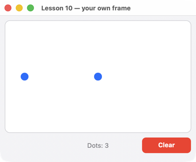

# Lesson 10. Your own frame

**English** · [Русский](../../ru/rust/lessons/10-frame.md)

**What you'll get:** a field where a click places a blue dot, a dot counter and a "Clear" button — without screens or elements: the program builds the frame of primitives itself.



<!-- code: crates/uison/examples/10-frame.rs -->
```rust
//! Lesson 10: your own frame, without Ui and screens. The program builds the frame from primitives (rectangles,
//! circles, text, hit areas) and handles events itself: the `App` trait and the `Writer` builder.
//! A click on the field places a dot, the "Clear" button removes them all.
use uison::{App, Color, Cursor, Event, Font, Host, MouseButton, Point, Rect, Size, Writer};

const BACKGROUND: Color = Color::rgb(0xF5, 0xF5, 0xF7);
const BORDER: Color = Color::rgb(0xD2, 0xD2, 0xD7);
const MUTED: Color = Color::rgb(0x86, 0x86, 0x8B);
const RED: Color = Color::rgb(0xFF, 0x3B, 0x30);
const BLUE: Color = Color::rgb(0x00, 0x7A, 0xFF);

#[derive(Default)]
struct Dots {
    dots: Vec<Point>,
}

impl Dots {
    fn render(&self, host: &dyn Host) -> String {
        let mut w = Writer::new(Size::new(400.0, 300.0), BACKGROUND);
        w.rect(Rect::new(10.0, 10.0, 380.0, 230.0)).radius(10.0).fill(Color::WHITE).stroke(BORDER, 1.0);
        w.hit(Rect::new(10.0, 10.0, 380.0, 230.0), "field", Cursor::Pointer);
        // A centered label: the platform measures the text width.
        let label = format!("Dots: {}", self.dots.len());
        let width = host.measure(&label, &Font { size: 13.0, ..Font::default() }).width;
        w.text(&label, Point::new(200.0 - width / 2.0, 258.0)).size(13.0).color(MUTED);
        w.rect(Rect::new(290.0, 250.0, 100.0, 32.0)).radius(8.0).fill(RED);
        w.text("Clear", Point::new(323.0, 257.0)).size(13.0).bold().color(Color::WHITE);
        w.hit(Rect::new(290.0, 250.0, 100.0, 32.0), "clear", Cursor::Pointer);
        for p in &self.dots {
            w.circle(*p, 8.0).fill(BLUE);
        }
        w.finish()
    }
}

impl App for Dots {
    fn frame(&mut self, host: &dyn Host) -> String {
        self.render(host)
    }

    /// `hit` is the id of the hit area under the cursor. `None` when the frame didn't change.
    fn on_event(&mut self, e: &Event, hit: Option<&str>, host: &dyn Host) -> Option<String> {
        match (e, hit) {
            (Event::MouseDown(_, MouseButton::Left), Some("clear")) => self.dots.clear(),
            (Event::MouseDown(p, MouseButton::Left), Some("field")) if self.dots.len() < 64 => self.dots.push(*p),
            _ => return None,
        }
        Some(self.render(host))
    }
}

fn main() {
    uison::run(Dots::default(), "Lesson 10 — your own frame");
}
```

## How it works

1. **The lower level.** `Ui` is itself an application: it implements the `App` trait, and underneath it is a frame of primitives. Your own `App` takes from uison only the window, drawing, redrawing what changed, and hit testing.
2. **The frame.** `Writer` builds it with chained calls: `rect`, `circle`, `line`, `tri`, `poly` (polygon), `text`, `image`, `begin_clip`/`end_clip`; shapes have `fill`, `stroke`, `radius`; `hit(rect, id, cursor)` is an invisible mouse area. `finish()` returns the finished frame string.
3. **Events.** `on_event` receives an event (`Event::MouseDown(point, button)`, `Key`, `Scroll`, `Resize`…) and `hit` — the id of the area under the cursor. Return a new frame with `Some(…)`; if the frame hasn't changed, `None`. Only what changed is redrawn: frames are diffed.
4. **Text.** The platform measures the width of a string: `host.measure(text, &Font { size, .. })`.
5. **When you need this.** Charts, editors, games, custom elements with non-standard drawing. Everything else is easier with a screen — it has states, focus, scrolling, text input.

## Try it

- Connect the dots with lines: `w.line(a, b).color(…).width(2.0)`.
- Drag a dot: remember it on `MouseDown`, move it on `MouseMove`, release it on `MouseUp`.

Next — [lesson 11: everywhere](11-everywhere.md).
